# אפיון: סריקת מסמכי רכש לפריוריטי

> **סטטוס: פיילוט קבלת סחורה — קוד ראשון נכתב (04.11.26).** ראו "מימוש". שאר האפיון — דרישות. הקובץ מסכם את מה שסוכם עד כה, כדי שכל שיחה
> חדשה תמשיך מכאן.

## המטרה

**סוכם 03.11.26:** הבוט עושה אוטומציה רק לשני שלבים: **קבלת סחורה** מסריקת תעודת משלוח,
ו**התאמת חשבונית** מול ה-GR. דרישת רכש והזמנת רכש נשארות ידניות בפריוריטי.

## תהליך הרכש כפי שהוא היום

1. **מנהל העבודה** מבקש חומר מאיש הלוגיסטיקה: בעל פה, בוואטסאפ או בכל דרך אחרת.
2. **איש הלוגיסטיקה** פותח **דרישת רכש** (`PD…`) בפריוריטי ושולח אותה לרכש.
3. **הרכש** הופך את הדרישה ל**הזמנת רכש** (`PO…`), ושולח אותה לספק. העתק עובר למנהל העבודה,
   עם איש הקשר, מועד האספקה והכמות. לפעמים הספק מאשר פחות, למשל 50 מתוך 100.
4. **הסחורה מגיעה עם תעודת משלוח.** המקבל בודק מה הגיע בפועל. למשל: הוזמנו 200 מלטות, ו-100
   הגיעו שבורות והוחזרו לנהג. אם זה כתוב בתעודה, מצוין. אם לא, הוא מתקן ידנית. אחר כך הוא
   קולט **קבלת סחורה** (`GR…`) מול ההזמנה, בכמויות שהתקבלו בפועל, ומאשר.
5. **החשבונית מגיעה** עם אותם מספרים: הזמנה ותעודת משלוח. הנהלת החשבונות מושכת את ה-GR
   ומשווה. **סכום החשבונית שווה לסכום שהתקבל: סיימנו. לא שווה: בודקים מה קרה.**

## מה הבוט עושה

| שלב | מי | מה הבוט עושה | בהיקף |
|---|---|---|---|
| **דרישת רכש** | מנהל עבודה / מהנדס ביצוע | רשימה בצילום, הקלטה או הקלדה ← דרישה בפריוריטי ← "מחכה לאישור"; החותם הבא מקבל וואטסאפ | ✅ (08.11.26 — ראו "דרישת רכש") |
| הזמנת רכש | רכש | — | ❌ ידני |
| **קבלת סחורה** | המקבל באתר | סורק תעודת משלוח, משווה להזמנה, שואל מה התקבל בפועל, קולט GR | ✅ |
| **חשבונית** | הנהלת חשבונות | סורק חשבונית, קולט לפריוריטי, מושך את ה-GR, משווה ומסביר פערים | ✅ |

### קבלת סחורה: תעודת משלוח → GR

1. **בחירת חברה.** ראו "בחירת חברה (סביבה)" למטה.
2. **המקבל מצלם את תעודת המשלוח** ושולח לבוט.
3. **הבוט קורא את התעודה:** ספק, מספר תעודה, מספר הזמנה (אם רשום), שורות וכמויות.
4. **הבוט מוצא את ההזמנה הפתוחה** (`PORDERS`): לפי המספר שעל התעודה, ואם אין מספר, לפי ההזמנות
   הפתוחות של הספק. כמה הזמנות מתאימות: הבוט שואל. אין הזמנה: הבוט עוצר (ראו שאלות פתוחות).
5. **הבוט מציג טבלה להשוואה:**

   | פריט | בהזמנה | בתעודה |
   |---|---|---|
   | מלט | 200 | 200 |
   | מעדר | 10 | 10 |

   ושואל: **"זה מה שהתקבל בפועל? אם משהו חסר, נשבר או הוחזר, כתוב מה."**
6. **המקבל מתקן בשפה חופשית,** למשל "מלט קיבלתי רק 100, 100 שבורים הוחזרו". הבוט מעדכן את
   הטבלה ומציג אותה שוב.
7. **סיכום לפני "כן":** חברה, ספק, הזמנה, מספר תעודה, הכמויות בפועל וסכום לפני מע"מ ואחרי מע"מ.
8. **אחרי "כן",** הבוט קולט GR מול ההזמנה, בכמויות שהתקבלו בפועל. מספר התעודה נשמר ב-`BOOKNUM`,
   ותמונת התעודה מצורפת. הבוט מחזיר את מספר ה-GR.
9. **פער מול ההזמנה** (100 מתוך 200) נרשם בהערה על ה-GR, כדי שהרכש יראה אותו.

### פיילוט: קבלת סחורה (הוחלט 04.11.26)

מתחילים בקבלת סחורה בלבד. העיקרון: **הבוט לא עושה שום דבר לבד.** כל שאלה מגיעה לעובד, והמעבר
מטיוטא לסופי קורה רק אחרי אישור מפורש. בסוף התהליך העובד מקבל את מספר ה-GR.

#### תרשים זרימה

```mermaid
flowchart TD
    A["העובד: 'קבלת סחורה' + תמונה"] --> B["טעינת סקיל קבלת סחורה"]
    B --> C["קריאת המסמך הראשי:<br/>סוג, ח.פ. נמען, ספק, מס' תעודה,<br/>מס' הזמנה, שורות, כתב יד"]
    C --> D{"ח.פ. הנמען<br/>= חברה שלנו?"}
    D -- לא / לא ברור --> D1["שואל לאיזו חברה,<br/>או עוצר"]
    D -- כן --> E["מציג חברה + סביבה<br/>(🧪 test11 / 🏢 אמת) — אישור"]
    D1 --> E
    E --> F{"ספק לפי ח.פ.?"}
    F -- לא נמצא --> F1["חיפוש לפי שם"]
    F -- נמצא --> G["אישור ספק"]
    F1 --> G
    G --> H{"מס' הזמנה PO<br/>על המסמך?"}
    H -- כן --> I["שליפת ההזמנה"]
    H -- לא --> H1{"יש הזמנות פתוחות<br/>לספק?"}
    H1 -- כן --> H2["שואב את ההזמנות הפתוחות למסך ה-GR<br/>ומציע את המתאימה ביותר<br/>(לפי פריטים, כמויות, סכום) — אישור"]
    H1 -- לא --> H3{"אין הזמנה:<br/>'יש מס' הזמנה? אם לא —<br/>קולטים לפי המסמך בלבד'"}
    H3 -- העובד מזין מס' הזמנה --> I
    H3 -- לפי המסמך בלבד --> J2["שורות מהמסמך בלבד<br/>(בלי השוואה להזמנה)"]
    H2 --> I
    I --> J["השוואה שורה-שורה:<br/>הזמנה מול מסמך"]
    J2 --> K
    J --> K{"כתב יד / ערך<br/>לא ברור?"}
    K -- כן --> K1["מציע אפשרויות:<br/>'שורה 3 — 100 או 180?'"]
    K -- לא --> L
    K1 --> L["'זה מה שהתקבל בפועל?'<br/>העובד מתקן בשפה חופשית"]
    L --> M{"פריט תואם<br/>במדויק?"}
    M -- כן --> M1["פריט + תת פרק שלו"]
    M -- לא --> M2["פריט כללי 000<br/>+ שאלה על תת פרק"]
    M1 --> N
    M2 --> N["פרויקט: יש הזמנה — מההזמנה, בלי שאלה.<br/>אין הזמנה — הצעה מהמסמך + שאלה<br/>(למשל אלעד: 50 / 49 צפון / 49 דרום / 540)"]
    N --> O["סוג הזמנה:<br/>רכש אתרי / משרדי — אישור"]
    O --> P["'נספחים' — תמונות נוספות"]
    P --> Q["קליטה בפריוריטי כטיוטא:<br/>GR + שורות + נספחים<br/>+ דו-שיח פנימי (מי קיבל)"]
    Q --> R["קריאה חזרה מפריוריטי<br/>→ PDF לבדיקה"]
    R --> S{"'מאשר'?"}
    S -- תיקון --> T["עדכון הטיוטא"] --> R
    S -- מאשר --> U["GR סופי ✅<br/>מחזיר מספר GR"]
```

**1. טריגר.** העובד כותב או מקליט "קבלת סחורה" ומצרף תמונה. המילים האלה טוענות את הסקיל של קבלת
סחורה. בלי הטריגר הבוט לא מנחש שמדובר בקבלת סחורה.

**2. מסמך ראשי ונספחים.** התמונה הראשונה היא המסמך הראשי, תעודת משלוח או חשבונית, וממנה קוראים
את הנתונים. אחרי שהעובד כותב "נספחים", כל תמונה נוספת עולה כנספח. כל התמונות, כולל הראשית,
נשמרות בלשונית הנספחים של ה-GR (`EXTFILES_SUBFORM`). ✅ נבדק ב-test11.

**3. חברה.** לפי הח.פ. של הנמען על המסמך, למשל 512061185 = אשל הירדן יזום ובנין. הבוט מציג את
החברה ומבקש אישור. ראו "בחירת חברה".

**4. ספק.** לפי ח.פ., ואם אין, לפי שם. הבוט מבקש אישור.

**5. הזמנה.** יש שני סוגי מסמכים:
- **מסמך שמבוסס על הזמנה,** כלומר הגיע אחרי דרישה והזמנה. אם כתוב "מבוסס על הזמנה PO…", זה המקרה
  הפשוט: הבוט משווה בין ההזמנה למסמך ומאמת שורה-שורה.
- **אין מספר הזמנה על המסמך:** המערכת בודקת אם לספק יש **הזמנות פתוחות**. אם יש, היא **שואבת את כל
  הנתונים שלהן למסך קבלת הסחורה** ומשווה אותם למסמך: פריטים, כמויות, מחירים וסכום. היא מציעה את
  ההזמנה, או השורות, שהכי מתאימות, ומבקשת אישור. כמה הזמנות מתאימות באותה מידה: שואלת איזו.
  (אושר 04.11.26)
- **מסמך "בחלל ריק",** בלי דרישה ובלי הזמנה, ואין לספק הזמנות פתוחות. ממנו מתחיל תהליך התשלום.
  הבוט שואל: "יש מספר הזמנה?".
  העובד יכול **להזין מספר הזמנה**, ואז ממשיכים כמו במקרה הראשון. אחרת **קולטים לפי המסמך בלבד**:
  GR בלי הזמנה, עם השורות מתעודת המשלוח או מהחשבונית, בלי השוואה (הוחלט 04.11.26).
  כך נקלט דאר אלביאן.

**6. סוג הזמנה.** הבוט מציע **רכש אתרי** (`02`) או **רכש משרדי** (`01`) לפי הפריטים, ושואל.

**7. כתב יד.** תיקונים בכתב יד על המסמך מפוענחים. כשמשהו לא ברור, הבוט מציע אפשרויות, למשל:
"בשורה 3 התכוונת ל-100 או ל-180?".

**8. פריטים.** אם נמצא פריט בפריוריטי עם התיאור המדויק, הבוט משייך אותו עם תת הפרק ותת הנושא שלו.
אם לא נמצא, הבוט משייך לפריט כללי `000` עם תיאור הספק, ושואל לאיזה תת פרק.

**9. פרויקט.** **יש הזמנה: הפרויקט נלקח מההזמנה, בלי שאלה** (אושר 04.11.26). **אין הזמנה:** הבוט
מציע פרויקט לפי מה שכתוב על המסמך, ושואל בתוך המשפחה:
- "מבואות דרומיים": 207, 208, 203, 205 או הכללי?
- "אלעד", רכש אתרי: מגרש 50, 49 צפון, 49 דרום או 540?

**10. סיכום ו-PDF.** הבוט קולט את ה-GR **כטיוטא**, ומפיק PDF לבדיקה **מהשדות שהוזנו בפריוריטי**
(הוחלט 04.11.26: בשלב הזה בלי הדפסה רשמית). הבוט קורא את ה-GR בחזרה מפריוריטי, ולא מהטיוטה
שלו, כדי שהעובד יראה בדיוק מה נשמר. ראו "PDF לבדיקה".

**11. אישור.** רק אחרי "מאשר" מהעובד, ה-GR הופך לסופי. הבוט מחזיר את מספר ה-GR.

### הרצה על דאר אלביאן: איפה נתקעים בדרך לסופי (04.11.26)

`GR26000015` ב-test11, טיוטא.

| שלב | מצב | מה חסר |
|---|---|---|
| טריגר | ⚠️ | בבדיקה אני החלטתי שזו קבלת סחורה. בבוט צריך את המילים "קבלת סחורה" |
| חברה | ✅ | ח.פ. 512061185 → a160226 / test11. חסרה טבלת ח.פ. לכל החברות |
| ספק | ⚠️ | `601997` נמצא **לפי שם בלבד**, כי בכרטיס אין ח.פ. צריך אישור |
| הזמנה | ✅ | אין PO ("בגין הזמנה 6160687" הוא מספר של הספק). מסמך "בחלל ריק", ולכן נקלט לפי המסמך בלבד. מותר (04.11.26) |
| סוג הזמנה | ⚠️ | ריהוט משרדי, כנראה רכש משרדי (`01`). ב-GR אין שדה כזה, הוא רלוונטי רק בהזמנה |
| פריטים | ✅ | אף פריט לא תואם, אז הכול נקלט כ-`000` לפי הכלל |
| תת פרק | ⚠️ | `98` תקורות / `90-00` הוא ניחוש שלי (כמו פריטי ציוד משרדי). צריך אישור |
| פרויקט | ❌ | "חיפה-טנגיז" לא תואם אף פרויקט. ב-a160226 המועמדים הם `PR26000005` "מטה- כללי" או `PR26000040` "חיפה - עין הים". **צריך תשובה** |
| סכומים | ⚠️ | 19,765.08 מול 19,765.00. הנחת המסמך 0.51% מעוגלת. **צריך להחליט:** לקבל את ההפרש, או לתקן בשורה האחרונה |
| נספח | ✅ | תמונת החשבונית עלתה (`EXTFILENUM` 1, 2.4MB) |
| PDF לבדיקה | ✅ | הופק מהשדות שהוזנו. ראו "PDF לבדיקה" |
| מעבר לסופי | ⏸ | לא בוצע. לפי הכלל, רק אחרי אישור |

### פרויקטים: מאיפה הבוט יודע מה קיים

**נפתר (04.11.26):** מסך הפרויקטים פתוח ל-API בשם **`DOCUMENTS_p`** (p קטנה). רק `DOCPROJ` סגור.
הבוט קורא ממנו את כל הפרויקטים של החברה, בלי המבוטלים: 40 ב-a160226 (כולל "אלעד סנטר מגרש 49
צפון", שלא הופיע במסמכים), 5 ב-test11, 3 במורדות, 2 באלעד סנטר. אם המסך לא זמין, הבוט חוזר לרשימה
שנאספת מההזמנות ומקבלות הסחורה.

**חיפוש פרויקט (`matchProjects` ב-`server/priority.js`):**
- **רמז מהמסמך** (עיר, אתר, מקום אספקה): כל הפרויקטים שבשמם מופיעה מילה מהרמז, המתאימים ביותר
  קודם. "חיפה" ← "חיפה - עין הים". "אלעד" ← מגרש 49 דרום, 49 צפון, 50, 540.
- **שם בערך מהעובד:** כל המילים שכתב צריכות להתאים. "אלעד 49" ← 49 דרום ו-49 צפון. "מבואות 207" ←
  "מבואות דרומיים מגרש 207". "נהריה איצטדיון" ← "נהריה-מגדלי הנשיא איצטדיון".
- **כתיב חופשי:** נהריה = נהרייה, קרית = קריית, יקנעם = יוקנעם, בלי מקפים וגרשיים. מספר תואם רק כמספר
  שלם ("207" לא תואם "2070").
- **כמה התאמות:** "לאיזה מהם התכוונת?" ורשימה ממוספרת.
- **שפה חופשית:** אותיות שימוש ("באלעד", "לחיפה", "הצפוני"), אותיות סופיות ("צפון" ~ "הצפוני") ומילות
  קישור ("זה", "במגרש"). "זה לאלעד, במגרש 49 הצפוני" ← "אלעד סנטר מגרש 49 צפון". "49" ← 49 צפון ו-49
  דרום. "207" לבד ← מבואות דרומיים מגרש 207. מספר לבד הוא מספר מגרש, ומספר ברשימה נחשב רק עד 2 ספרות.
- **כינויים** (`skills/goods-receipt.md`, "כינויים לפרויקטים", ניתן לעריכה): `מבואות דרומיים = חיפה, מבואות חיפה,
  sea&cloud`. כך "חיפה" מציע את "חיפה - עין הים" ואת כל מבואות דרומיים, ו"חיפה 207" ← מגרש 207. מקורות
  הכינוי: המשתמש אמר ש-207 הוא חיפה, ובעותק test11 אותם קודים נקראים "מבואות חיפה sea&cloud".
- **AI כגיבוי:** כשהקוד לא מוצא אף פרויקט, ה-AI מתאים את הטקסט לרשימה (משימה `project` בסקיל). **הצעה
  אחת מה-AI מחכה ל"כן"**, וכמה הצעות מוצגות כרשימה.

**עותק הבדיקה (05.11.26):** בפיילוט נשלחה חשבונית של "יקנעם-נוף כרמל", והבוט לא מצא את הפרויקט. הקליטה הייתה
ל-test11, כי ב-Render `PRIORITY_COMPANIES` עדיין `test11`, ול-test11 יש רק 5 פרויקטים מיוני. עכשיו, כשהקליטה היא
לעותק הבדיקה ופרויקט לא נמצא בו, הבוט בודק בחברה האמיתית (קריאה בלבד) ואומר: "יוקנעם- נוף לכרמל (PR26000008)
קיים באשל הירדן יזום ובנין (a160226), אבל הקליטה הזו היא לעותק הבדיקה test11…", ומציג את פרויקטי test11 לבחירה.
**קריאה** מותרת לכל חברה מוכרת; **כתיבה** — רק לחברות שב-`PRIORITY_COMPANIES`.

**פרויקט ומחסן — הכללים (06.11):**
- **פרויקט אחד בחברה** (כמו דניה הירוקה, אלעד סנטר) — ברירת המחדל, בלי שאלה: "📁 פרויקט: דניה — הפרויקט היחיד בחברה".
- **כמה פרויקטים** — הבוט לא בוחר לבד: מציע לפי המסמך, ובלי הצעה מציג את כל הפרויקטים (עד 9), ומחכה לבחירה.
- **מחסן**: מההזמנה כשיש; **מחסן אחד** שאליו נקלטו קבלות הפרויקט — ברירת המחדל; **כמה** — "🏬 לאיזה מחסן לשייך?"
  עם שמות המחסנים (`TOWARHSDES`) ומספר הקבלות לכל אחד; **אף אחד** — מחסן הפרויקט אם כבר קלטו אליו בחברה, אחרת
  Main. מסך המחסנים סגור ל-API, ולכן הרשימה נבנית מקבלות הפרויקט (`projectWarehouses`).

**מחסן — עדכון 06.11 (ב): מסך המחסנים (`WAREHOUSES`) נפתח ל-API.** לכל מחסן יש שיוך לפרויקט (`DOCNO`, `PROJDES`).
ב-a160226 36 מתוך 41 המחסנים משויכים לפרויקט (מחסן אחד לכל פרויקט); באלעד 1 מתוך 5; בדניה הירוקה 0 מתוך 4 —
ושם אין מחסן `01` בכלל, וזו הסיבה שהטיוטא נכשלה. הסדר עכשיו:
1. המחסן מההזמנה — אם הוא קיים במסך המחסנים.
2. המחסנים ששויכו לפרויקט במסך המחסנים; אם אין שיוך — המחסנים שאליהם נקלטו קבלות הפרויקט (רק כאלה שקיימים).
   **אחד** — ברירת המחדל; **כמה** — "🏬 לאיזה מחסן לשייך?" עם שמות המחסנים.
3. אף אחד — מחסן הפרויקט (`BUD_WARHSNAME`) רק אם הוא קיים במסך המחסנים; אחרת `Main` (או המחסן הכללי היחיד).
4. לפני פתיחת הטיוטא המחסן נבדק שוב מול המסך; ואם פריוריטי בכל זאת דוחה — `Main`, עם רישום בדו-שיח הפנימי.
✅ נבדק (קריאה בלבד): דניה הירוקה → `Main`; a160226: 207 → `139`, 208 → `140`, מבואות דרומיים → `100`, אלעד 50 → `102`;
אלעד → `Main`; test11: סקאי פארק → `102`.

**מחסן — עדכון 06.11: נלמד מהקבלות הקודמות.** בפיילוט בדניה הירוקה הטיוטא נכשלה: מחסן הפרויקט "דניה" הוא `01`,
וכל 7 הקבלות בחברה נכנסו ל-`Main` (`01` לא שימש אף פעם). בדיקה: ב-a160226 132 מתוך 194 קבלות נכנסו למחסן הפרויקט;
בדניה הירוקה 0/7, באלעד 1/27, במורדות 0/3. עכשיו (`warehouseOf`): המחסן הנפוץ בקבלות של אותו פרויקט; אחרת מחסן
הפרויקט רק אם כבר קלטו אליו בחברה; אחרת `Main`. ואם פריוריטי דוחה את המחסן — ניסיון חוזר ל-`Main`, ורישום בדו-שיח
הפנימי ("מחסן 01 נדחה בפריוריטי, נקלט ל-Main").

**מחסן (הוחלט 04.11.26): הסחורה נקלטת למחסן של הפרויקט.** ב-`DOCUMENTS_p` יש לכל פרויקט מחסן
(`BUD_WARHSNAME`, למשל 118 ל"חיפה - עין הים"). הבוט קולט אליו, ולפרויקט בלי מחסן (למשל מבואות
דרומיים 207/208/כללי) קולט ל-`Main`. ✅ נבדק ב-test11: GR לפרויקט PR26000005 נפתח במחסן `100`, וגם
השורה שנמשכה מההזמנה קיבלה מחסן `100`. בסיכום ובקובץ ה-PDF מוצג המחסן.

(ההיסטוריה למטה נשארת לתיעוד.)

- **אין גישת API למסכי הפרויקטים.** נבדקו `DOCPROJ`, `PROJLIST`, `MEDR_SYSPROJECTS`, `PROJBAL`
  ועוד. כולם מחזירים "לא ניתן להפעיל API למסך זה". **לבקש מ-Medatech** הרשאה ל-`DOCPROJ`.
- **הדרך הנכונה:** בממשק, הפרויקט נבחר מתוך שדה הפרויקט במסך קבלות סחורה. ב-REST אין
  רשימות בחירה, ואפשר רק לכתוב קוד שפריוריטי בודק. ב-Web SDK יש `form.choose('PROJDOCNO', 'אלעד')`,
  שמחזיר את אותה רשימה שהעובד רואה, וזו הדרך המועדפת. לא נבדק עדיין (ראו "הדפסה ל-PDF", אותה ספרייה).
- **פתרון ביניים:** רשימת פרויקטים שנאספת מהמסמכים (`PROJDOCNO`, `PROJDES` בהזמנות, ב-GR ובחשבוניות).
  ב-a160226 נמצאו כך 30 פרויקטים. ביניהם: `PR26000001`–`03` מבואות דרומיים (207, 208, כללי),
  `PR26000017` / `18` מבואות דרומיים 203 / 205, `PR26000004` אלעד סנטר מגרש 50, `PR26000015` אלעד סנטר
  מגרש 49 דרום, `PR26000016` אלעד סנטר מגרש 540, `PR26000005` מטה- כללי. **"אלעד 49 צפון" לא הופיע**, כי
  פרויקט בלי מסמכים לא נמצא בשיטה הזו. לכן צריך את `DOCPROJ`.
- ⚠️ **ב-test11 שמות הפרויקטים שונים מ-a160226 עבור אותו קוד.** למשל, `PR26000005` הוא "מבואות חיפה sea&cloud
  מגרש 201" ב-test11, ו"מטה- כללי" ב-a160226. כנראה שמות שונו אחרי ההעתקה. **אסור להעביר קוד פרויקט
  בין חברות.** הבוט תמיד מחפש מחדש בחברה שנבחרה.
- **ייתכנו גם סעיפים בתוך פרויקט** (`MED_SECTION` בשורות חשבונית, למשל "01 מגרש 203"). לבדוק אם ב-GR
  צריך לשייך גם סעיף.

### בדיקה: GR מול הזמנה פתוחה וקבלה חלקית ב-test11 (04.11.26)

**איך זה עובד ב-API (✅ נבדק):**
1. פותחים GR טיוטא עם ספק (`POST DOCUMENTS_P`).
2. **`DOCPORDI_SUBFORM` של ה-GR מציג לבד את כל שורות ההזמנות המאושרות והפתוחות של הספק,**
   עם הכמות שהוזמנה (`TQUANT`) והיתרה (`TBALANCE`). זה המנגנון של "המערכת מזהה הזמנות פתוחות".
   לספק `200001` הופיעה `PO26000005`, שורה 1: בטון ב-15, 500, יתרה 500.
3. **סימון שורה** (`PATCH DOCPORDI_SUBFORM(KLINE=…,ORD=…)` עם `FLAG: 'Y'`) יוצר שורת GR מקושרת
   להזמנה (`ORDNAME`, `OLINE`). השורה מקבלת מההזמנה **מחיר, תת פרק, תת נושא ופרויקט** (`BUD_DOCNO`).
   הכמות שמתקבלת היא 0, והבוט ממלא אותה.
4. **קבלה חלקית:** כמות 100 בשורה (`PATCH TRANSORDER_P_SUBFORM(KLINE=1,TYPE='P')`) נתנה סה"כ
   15,000 + 2,700 = 17,700.
5. **היתרה בהזמנה מתעדכנת כבר בטיוטא:** 500 ירדה ל-400. אחרי מחיקת השורה היא חזרה ל-500.
   יתרה של 400 נשארת פתוחה לאספקה הבאה.
   **הוחלט:** הבוט אף פעם לא סוגר יתרה בהזמנה, גם כשהמקבל כותב שהשאר לא יגיע. סגירת יתרות
   נעשית ידנית ברכש. הבוט רק רושם את הפער בדו-שיח הפנימי, למשל "התקבלו 100 מ-500, 100 שבורים הוחזרו".

**מה זה אומר לבוט:**
- **אין צורך לחפש הזמנות בנפרד.** פותחים GR לספק, וקוראים את `DOCPORDI_SUBFORM`: זו רשימת ההשוואה.
  הבוט מתאים כל שורה בתעודה לשורה פתוחה (פריט, כמות, יתרה), מסמן אותה, וממלא את הכמות שהתקבלה.
- **ה-GR "תופס" יתרה כבר בטיוטא.** GR טיוטא שננטש משאיר את ההזמנה מוקטנת. הבוט צריך לבטל
  טיוטא שלא אושרה: למחוק את השורות, ואז `STATDES = מבוטלת`.
- ⚠️ **הפרויקט בכותרת ה-GR לא מתעדכן מההזמנה.** השורה קיבלה `PR26000005` מההזמנה, והכותרת
  נשארה `PR26000003`, כפי שהבוט כתב. **כשיש הזמנה, הבוט מעתיק את פרויקט ההזמנה לכותרת**, ולא
  מציע פרויקט משלו.

**הזמנה חדשה דרך ה-API לא יכולה להיות מאושרת.** `STATDES = אושרה` נחסם: "יש להשתמש בפעולה
'אישור הזמנת רכש'". זה לא משנה לפיילוט, כי ההזמנות נפתחות ומאושרות ידנית ברכש.

**ניקוי:** `GR26000016` בוטל. `PO26000021` עברה לטיוטא ואז בוטלה (ישר ל"מבוטלת" נחסם). היתרה של
`PO26000005` חזרה ל-500.

### תנאי תשלום (הוחלט 05.11.26): חובה, וברירת המחדל שוטף + 45

- **השדה:** `MED_MXPAYCODE` בכותרת ה-GR. ✅ נבדק ב-test11: הקוד נכתב ביצירה ובעדכון, ופריוריטי דוחה
  קוד שלא קיים ("ערך '99' לא קיים בעמודה 'קוד תנאי תשלום'").
- **הקודים:** מסך תנאי התשלום (`PAY`) סגור ל-API. הרשימה נאספה מהזמנות, ספקים וקבלות סחורה, והיא זהה
  ב-a160226, ב-test11 וב-elad1: `01` שוטף, `02` ש15, `03` ש30, **`04` ש45**, `05` ש60, `08` ש75, `06` ש90.
  ש45 הוא גם הנפוץ ביותר (1,842 מסמכים ב-a160226).
- **בבוט:** בכותרת מוצג "💳 תנאי תשלום: שוטף + 45 (ברירת מחדל)". העובד יכול לשנות במילים: "שוטף 60",
  "ש90", "שוטף+30", "שוטף" לבד. אפשר לשנות גם בבדיקת הטיוטא, וה-GR מתעדכן. מספר ימים שאין לו קוד
  ("שוטף 50") מקבל את רשימת האפשרויות.
- **בסיכום וב-PDF** מוצג תנאי התשלום. כשיש הזמנה עם תנאי אחר, מוצג "⚠️ בהזמנה: שוטף + 60".
- **בדו-שיח הפנימי:** "תנאי תשלום: שוטף + 45 (ברירת מחדל)", או "(נבחר ע"י המקבל)".
- **מועד התשלום — מתאריך החשבונית** (05.11.26): "שוטף" = סוף החודש של תאריך החשבונית; "שוטף + N" = סוף החודש
  ועוד N ימים. חשבונית מ-15.03.2026, שוטף + 45 ← 15.05.2026. ה-AI קורא בנפרד את תאריך המסמך (`doc_date`) ואת
  תאריך האספקה (`date`). מוצג בכותרת ("לתשלום עד 15.05.2026 (מתאריך החשבונית 15.03.2026)"), בסיכום, ב-PDF
  ובדו-שיח הפנימי, ומתעדכן כשמשנים את התנאים.

### מק"ט, תת פרק ומשאב — נלמד מקבלות הסחורה הקודמות (05.11.26)

**הבעיה בפיילוט:** בדניה הירוקה לא היה לקבוצת העתקות שום GR, ולכן לא הייתה הצעה לתת פרק. "כן" בלי הצעה
לא נקלט, והבוט שאל שוב ושוב. "מק"ט העתקות" לא הובן.

**עכשיו — לכל שורה בלי הזמנה, תמיד יש מק"ט, תת פרק ומשאב** (`codeLines`):
1. פריט שתיאורו זהה בקטלוג — עם תת הפרק והמשאב שלו.
2. **המק"ט שהספק נקלט בו בעבר — בכל החברות**: בחברה הזו לפי קוד הספק, ובשאר **לפי ח.פ.** (במקביל), במשקל כפול
   לחברה הזו
   (קטלוג הפריטים משותף; המק"ט נבדק שקיים ופעיל בחברה הנוכחית, והקידוד נלקח ממנה). כמה מק"טים — הקרוב
   ביותר בתיאור, אחרת הנפוץ. קבוצת העתקות: **A120-035-010 העתקות · ייזום (A120) / העתקות (A120-035)**.
3. **שורות דומות בתיאור, מכל ספק ומכל חברה** (06.11 — "המק"טים פועלים ברמה הרב חברתית"): אינדקס של השורות
   (לא 000) מ-300 הקבלות האחרונות בכל חברה, נבנה ברקע (חברה אחת בכל סבב של 10 דקות) ומתרענן כל 12 שעות.
   התאמה: לפחות 2 מילים משותפות ולפחות חצי מהמילים של השורה. למשל "שכ"ט עו"ד" ← A120-080-003 הוצאות משפטיות.
4. הספק נקלט בעבר ב-000 — באותו תת פרק ומשאב.
5. אחרת — **מק"ט כללי 000** בתת הפרק והמשאב הכלליים של החברה: הצירוף הנפוץ ביותר עם 000 ב-300 הקבלות
   האחרונות, ואם אין — **101 כללי / 98-10 כללי** (קיים בכל החברות שנבדקו).

**בשיחה** — במקום "לאיזה תת פרק?": "🏷 כל 2 השורות ← A120-035-010 העתקות · ייזום / העתקות (כמו בקליטות
קודמות של הספק (באשל הירדן יזום ובנין))". *כן* ממשיך. לשינוי: מק"ט ("A120-035-010"), "שורה 2 A120-035-010",
מילה מהתיאור ("מק"ט העתקות" ← חיפוש בקטלוג), או *כללי*. כמות שבורה ביחידה שלמה — כמות 1 בסכום השורה.

✅ נבדק: דניה הירוקה/קבוצת העתקות ← A120-035-010 (נלמד מ-a160226 לפי ח.פ.); a160226 ← A120-035-010; ספק בלי
היסטוריה ← 000 כללי/כללי. שיחה ב-test11: "מק"ט העתקות", "כללי", "שורה 2 01-20-0002", ובפריוריטי נשמרו הקודים.

### חשבונית מס + חשבון לתשלום (05.11.26)

אצל חלק מהספקים (למשל קבוצת העתקות) **חשבונית המס היא הסכום בלבד** — שורה אחת "ח-ן לתשלום 2011796" — **והפירוט
בחשבון לתשלום**. בקבלת הסחורה:
- **השורות** — מהחשבון לתשלום (פריטים, כמויות, מחירים, הנחות).
- **מספר התעודה (`BOOKNUM`)** — של החשבונית. **הבקרה** — הסכום לפני מע"מ ב-GR מול **לפני מע"מ בחשבונית**.
  הפרש עיגול (פחות מ-1 ₪) מוצג כ-✅ "עיגול", לא כבעיה. הנחת מסמך זעירה או שלילית (עיגול) אינה נקלטת.
- הבוט מזהה זאת כשבחשבונית עד 2 שורות, ומספר המסמך הנוסף מופיע בהן. ביחד באלבום, או כשהחשבון נשלח אחרי
  החשבונית — גם אחרי שלב השורות (ואז ההשוואה להזמנה והשורות מוצגות מחדש).
- בדו-שיח הפנימי: "פירוט השורות: מתוך חשבון לתשלום 2011796". האזהרה "אין פירוט פריטים" נעלמת.

**פריט כללי 000 נמדד ב"יח'" ומקבל רק כמות שלמה.** כמות שבורה (2.30 מ"א) נקלטת ככמות 1 בסכום השורה אחרי ההנחה,
והכמות והיחידה המקוריות בתחילת התיאור ("2.3 מא · פלוט צבע מעל 1.2").

✅ נבדק ב-test11 בשלושת הסדרים (אלבום, חשבון בכותרת, חשבון אחרי השורות): 3 שורות, 75.40 לפני מע"מ מול 75.42
בחשבונית ← ✅ עיגול.

### נספח או מסמך חדש, וטיוטות שלא אושרו (05.11.26)

**מתי הבוט כותב לפריוריטי:** טיוטא נוצרת רק כש"סיום" או "אין" נכתבים בשלב הנספחים, אחרי שהכותרת, השורות
והפרויקט אושרו. "מאשר" הופך אותה לסופית. עד הטיוטא — קריאה בלבד.

**קובץ נוסף בשלב הנספחים או בבדיקת הטיוטא:**
- כיתוב "נספח" ← נספח. כיתוב "קבלת סחורה" ← מסמך חדש.
- בלי כיתוב — ה-AI מסווג (משימה `classify` בסקיל). תמונה של הסחורה, דף נוסף או תעודה של אותה הזמנה ← נספח,
  בלי שאלה. מספר מסמך אחר או ספק אחר ← "📄 זה נראה כמו מסמך חדש: חשבונית 777 של … *1* — לצרף כנספח · *2* —
  קבלת סחורה חדשה". כשהסיווג נכשל — שואלים.
- **מסמך חדש לא מבטל את הנוכחית בשקט.** הוא ממתין בתור. בנספחים — הנוכחית נקלטת כטיוטא לבדיקה. בבדיקה —
  "*מאשר* או *ביטול*". אחר כך הבוט עובר לבד למסמך שבתור ("↪️ עובר למסמך הבא…"), בלי לשלוח אותו שוב.

**טיוטא שלא אושרה** (שורה מהזמנה תופסת יתרה כבר בטיוטא): סבב הבוט בודק פעם ב-10 דקות.
- **אחרי 4 שעות** בלי תשובה בבדיקת הטיוטא — תזכורת לעובד: "⏳ GR… מחכה לאישור שלך. *מאשר* או *ביטול*".
- **אחרי 24 שעות** — הטיוטא מבוטלת (מספר התעודה מתפנה), העובד מקבל הודעה, ומנהל המערכת התראה.
- הזמן נמדד מההודעה האחרונה של העובד בקליטה. הודעות יזומות יוצאות בשעות הפעילות של הבוט, ומחוץ להן — בתור.

✅ נבדק ב-test11 עם AI מדומה: נספח בלי שאלה; מסמך חדש ← 2 ← טיוטא לנוכחית ← ביטול ← מעבר לבא; "נספח" בכיתוב
בבדיקה; מסמך חדש ← 1 ← נספח; 5 שעות ← תזכורת; 25 שעות ← GR26000030 בוטל, הודעה לעובד והתראה למנהל.

### אגרות, שוברים וכל מסמך ספק (05.11.26)

"בדרך כלל אפשר לעשות קבלת סחורה מכל דבר." עד עכשיו, מסמך שאינו תעודת משלוח או חשבונית (למשל אגרת שלטים
של עיריית אלעד) בוטל מיד. מעכשיו:
- סוג חדש `payment`: שובר תשלום, אגרה, חשבון עירייה, חשבון לתשלום, קבלה, חשבון עסקה — נקלט כרגיל. הרשות היא הספק.
- `doc_label`: שם המסמך כפי שכתוב עליו ("אגרת שלטים"). הוא מוצג בסיכום, בנספחים ובדו-שיח הפנימי.
- מסמך בלי טבלת פריטים: שורה אחת — התיאור ומספר המסמך, כמות 1, הסכום לפני מע"מ.
- `other` רק כשזה לא מסמך ספק בכלל, או כשלא בטוח. אז הבוט **שואל** "לקלוט אותו בכל זאת כקבלת סחורה? כן / לא",
  ולא מבטל.
- באלבום, אגרה או שובר יכולים להיות המסמך הראשי (והתמונות של השלטים — נספחים).
✅ נבדק בשיחה מדומה ב-test11: אגרה → ממשיך לספק עם שורה "אגרת שלטים 3145174", 4,631.50; מסמך לא ברור → שאלה,
"כן" ממשיך, "לא" עוצר.

### אגרת השלטים באלעד סנטר — מה השתבש ומה תוקן (05.11.26)

1. **המסמך הראשי:** באלבום של שובר + דף תמונות השלטים, נבחר דף השלטים (בלי מספר) כמסמך הראשי, והשובר נכנס
   לנספחים. מעכשיו מסמך עם מספר (חשבונית, תעודה, שובר) קודם לדף בלי מספר.
2. **החברה:** בשובר כתוב "מספר חשבון משלם 516888187" — זה הח.פ. של אלעד סנטר. נוסף `other_ids`: כל מספר
   שיכול להיות ח.פ., מודפס או בכתב יד. החברה מזוהה לפי ח.פ. הנמען, אחרת לפי כל מספר אחר במסמך, אחרת לפי שם
   הנמען — רק כשהוא מתאים לחברה אחת ("אלעד סנטר בע'מ" ← elad1; "אשל הירדן" — כמה חברות, שואלים). בסיכום כתוב
   "זוהתה לפי מספר במסמך" / "לפי שם הנמען".
3. **ח.פ. בכתב יד:** "ח.פ. 500213095" (עיריית אלעד, ספק 700003) נקרא 800213095. כשאין ספק עם הח.פ., מנסים
   ספרה אחת אחרת (5/8, 1/7, 0/6…) — ומתקבל רק כשגם השם דומה.
4. **המחסן:** "משהו השתבש מול פריוריטי" אחרי "אין". `Main` קיים ב-elad1 ושימש בכל הקבלות של PR26000001, כך
   שסיבת הדחייה לא ברורה (הפירוט — בהתראה למנהלים). מעכשיו: פריוריטי דוחה את הכותרת — מנסים עד 3 מחסנים אחרים
   של החברה; עדיין נדחה — הבוט **שואל** לאיזה מחסן לשייך, עם הרשימה ממסך המחסנים; נכשל שוב — "הכל שמור, נסו
   שוב", והפירוט למנהלים. לא "משהו השתבש".
5. **שינוי מחסן:** אחרי בחירת המחסן מוצגים שאר המחסנים של החברה — "לשנות מחסן — כתבו מספר".
✅ נבדק בשיחות מדומות ב-test11 (בלי כתיבה): אלבום ← השובר ראשי, החברה elad1 לפי 516888187; ח.פ. 800213095 ←
עיריית אלעד (700003) ב-elad1 (קריאה); דחייה מדומה של הכותרת ← ניסיון חוזר, שאלה על מחסן, ואז "הכל שמור".

### ללא מע"מ — אגרות, ארנונה, שכר דירה (05.11.26)

בקבלת סחורה יש שדה **קוד מס** (`TAXCODE`). מסך המסים (`TAXES`) סגור ל-API, ולכן הקודים נלמדו מהקבלות:
`002` — עם מע"מ (כמעט כל הקבלות); `000` — ללא מע"מ (ב-a160226: עו"ד, שכר דירה, מתנ"ס; גם `006`/`007` מופיעים עם מע"מ 0,
בודדים). הרשימה המלאה (מהמסך בפריוריטי, 05.11.26): `000` פטור ממע"מ · `002` מע"מ תשומות · `003` מע"מ תשומות לנכסים ·
`006` מע"מ נקבע ידנית · `007` מע"מ בשיעור 0. לאגרה, ארנונה, שכר דירה ועוסק פטור — `000`. ✅ נבדק ב-test11: `PATCH TAXCODE=000` ← מע"מ 0 (100 → 100); חזרה ל-`002` ← 118.

- **זיהוי:** במסמך יש סכום ואין מע"מ (`vat` = 0) — ללא מע"מ. הסקיל מורה ל-AI לא לחשב מע"מ שלא מופיע במסמך.
- **בסיכום:** "🧾 מע"מ: *ללא מע"מ* — במסמך אין מע"מ". העובד יכול לשנות: *עם מע"מ* / *ללא מע"מ*.
- **בטיוטא:** אחרי פתיחת ה-GR — `TAXCODE` = `000`; נכשל — אזהרה לעובד ("שנו בפריוריטי") ופירוט למנהלים.
- **בדו-שיח הפנימי:** "מע"מ: ללא מע"מ (קוד 000) — במסמך אין מע"מ" / "נבחר ע"י המקבל".
✅ נבדק בשיחה מלאה ב-test11: אגרה 4,531.50 ← GR26000044 עם מע"מ 0, סה"כ 4,531.50; עם "עם מע"מ" ← GR26000045 עם
מע"מ 815.67. שתי הטיוטאות בוטלו.

### טיוטא שאושרה או בוטלה במחשב (05.11.26)

העובד פתח קבלה בבוט, והטיוטא אושרה ישר בפריוריטי במחשב. עד עכשיו הבוט נשאר "תקוע" עליה: "מאשר" ניסה לאשר
שוב, ו"ביטול" ניסה לבטל GR סופי (מחיקת שורות ושינוי מספר התעודה). מעכשיו:
- בכל הודעה, כשיש טיוטא — הבוט בודק את הסטטוס שלה בפריוריטי. היא כבר *סופית* או *מבוטלת* — הקליטה בבוט נסגרת:
  "ℹ️ GR… כבר סופית בפריוריטי (עודכנה במחשב), ולכן סגרתי אותה בבוט", וההודעה מטופלת כהתחלה חדשה (מסמך חדש
  ממשיך ישר; מסמך שחיכה בתור — עובר אליו).
- `cancelReceipt` מבטל **רק טיוטא**. GR סופי או מבוטל — לא נוגעים בו (גם בביטול האוטומטי אחרי 24 שעות).
- "מאשר" על GR שכבר סופי — לא מאשר שוב, רק מסכם.
✅ נבדק ב-test11: GR26000046 ו-GR26000047 נפתחו בבוט ואושרו ישר בפריוריטי; "ביטול" ← שוחרר, הסטטוס נשאר סופית;
"קבלת סחורה" עם מסמך חדש ← שוחרר והמשיך ישר לחדש.

### רשימת פריטים בנספח (05.11.26)

העובד שלח באמצע השיחה (בשלב "זה מה שהתקבל בפועל?") את דף השלטים של אגרת השלטים. הבוט שמר אותו כנספח בלבד,
והשורה נשארה "אגרת שלטים לשנת 2026". מעכשיו, כשלמסמך הראשי שורה אחת או שתיים ומגיע נספח עם רשימת פריטים
(2 שורות ומעלה), לפני שנפתחה טיוטא:
- **הסכום תואם** לסכום לפני מע"מ במסמך (עד 1 ₪) — השורות מתעדכנות לפי הרשימה: "📋 בנספח יש רשימה של N פריטים,
  והסכום תואם — עדכנתי את שורות הקבלה לפיה".
- **לא תואם** — שואלים: "לעדכן את שורות הקבלה לפי הרשימה? *כן* / *לא*". *לא* — נשאר נספח בלבד.
- אחרי העדכון: כבר נבחר "בלי הזמנה" — ישר לשורות החדשות; אחרת — השוואה מחדש עם ההזמנות.
- גם באלבום (מסמך + דף רשימה ביחד) — אותו כלל.
- בסיכום ובדו-שיח הפנימי: "הפירוט מרשימת הפריטים שבנספח".
✅ נבדק בשיחה מדומה ב-test11: סכום תואם ← 3 שורות, ישר ל"זה מה שהתקבל"; סכום שונה ← שאלה, "כן" ← 3 שורות.

### מחסן בלי לעצור, ו"סיום" אחד (05.11.26)

- **המחסן לא עוצר את השיחה.** לפרויקט כמה מחסנים — נבחר **המחסן הראשי (`Main`)** אם הוא ביניהם, אחרת הנפוץ בקבלות
  הפרויקט. בהודעה: "🏬 מחסן: *מחסן ראשי* (Main) · לשנות מחסן — כתבו *מחסן*". "מחסן" (או "מחסנים", "שנה מחסן",
  "פירוט מחסנים") בשלב הנספחים מציג את מחסני החברה עם מספרים, והמספר משנה. (שאלה על מחסן נשארת רק כשפריוריטי דחה
  את המחסן.) מחליף את הכלל מ-06.11 "כמה — שואלים".
- **"סיום" ו"אין" היו אותו דבר** — עכשיו ההודעה אומרת "כשסיימתם, או אם אין — *סיום*". "אין" עדיין מתקבל.
✅ נבדק בשיחה מדומה: מחסנים 100 ו-Main ← Main בלי שאלה; "מחסן" ← רשימה; "2" ← סקאי פארק (102).

### שם החברה, ובלי עותק הבדיקה ברשימה (05.11.26)

חשבונית של זיו (עו"ד) לנמען "אשל הירדן יזום ובנין בע"מ", בלי ח.פ. הבוט לא זיהה את החברה, כי גם שם עותק הבדיקה
("אשל הירדן יזום ובנין — סביבת בדיקה") התאים — שתי התאמות, אף אחת. ועותק הבדיקה הוצע לעובד כאפשרות ראשונה.
- עותק הבדיקה (test11) **אינו נספר** בהתאמת שם, ו**אינו מוצג** ברשימת החברות (רק אם הוא היחיד שפתוח).
- השם מנורמל: "ובניין" = "ובנין"; בע"מ / בע'מ / בעמ — לא חלק מהשם.
- ברשימה — החברות ששמן דומה לנמען ראשונות; אפשר לענות במספר **או בשם** ("אלעד").
✅ נבדק: "אשל הירדן יזום ובניין בע"מ" ← a160226; "אשל הירדן" ← שאלה (5 חברות), בלי test11; "אלעד" ← elad1.

### PDF בוואטסאפ (05.11.26)

PDF שנשלח בוואטסאפ מגיע מ-Green API עם **שם הקובץ בכיתוב** ("document (18).pdf"). הבוט חשב שנכתב טקסט עם הקובץ,
ולכן לא הציע קבלת סחורה, והעוזר הכללי ענה "קיבלתי את הקובץ… מה לעשות איתו?". אחר כך "קבלת סחורה" ביקש צילום שוב.
- מסמך (`documentMessage`) שהכיתוב שלו זהה לשם הקובץ — נחשב קובץ **בלי טקסט**: "לקלוט כקבלת סחורה? כן / לא", כמו תמונה.
- הקובץ האחרון שלא נקלט נשמר 15 דקות: "קבלת סחורה" בלי קובץ אחריו — ממשיך עם הקובץ ההוא, בלי לבקש שוב.
⚠️ לא נבדק מול וואטסאפ אמיתי (אין סביבת בדיקה ל-Green API) — לבדוק בשליחת PDF אחרי העלייה.

### שורה חסרה בחשבונית (05.11.26)

חשבונית של ג'י אי טי ברבץ רכסים: 4 שורות, נקראו 3 (ואחת בכמות 0) — 486.00 במקום 617.80. העובד צילם את הטבלה ושלח
בבדיקת הטיוטא, והיא נכנסה לנספחים בלבד.
- **קריאה שנייה:** סכום השורות שנקראו לא תואם לסה"כ השורות במסמך (יותר מ-1 ₪) — ה-AI קורא שוב את הטבלה, עם הסכומים
  ומספר השורות שמצא, ובהנחיה לחפש שורות דומות, שורות עם אותו מק"ט, שורות על שתי שורות טקסט ושורות בסוף הטבלה.
  נלקחת הקריאה שהסכום שלה קרוב יותר.
- **טבלה בבדיקת הטיוטא:** צילום עם שורות שהסכום שלהן קרוב יותר לסכום שבמסמך מהשורות שבטיוטא — הבוט מציג את השורות
  ושואל "לעדכן את שורות GR… לפי התמונה?". *כן* — אותו GR: השורות נמחקות ונכתבות מחדש (אחרי "זה מה שהתקבל" והקידוד),
  והמחסן, הפרויקט והנספחים נשארים. הצילום מצורף לנספחים בכל מקרה. בדו-שיח: "השורות נבנו מחדש לפי טבלה…".
✅ נבדק ב-test11: GR26000048 — 2 שורות, 486.00 ← טבלה ← 4 שורות, 617.80, אותו GR, 2 נספחים; בוטל. קריאה שנייה — נבדקה
עם תשובות קבועות (3 שורות ← 4).

### הוספת שורה, ו"ראה צילום" (05.11.26)

בבדיקת הטיוטא העובד כתב "תיקון · ראה צילום טבלה, חסר שורה", והבוט נכנס לשאלות ("מה לגבי שורה 2?", "לא הבנתי מה
פירוש 1"). התיקון בבדיקה ידע רק לשנות כמויות.
- **הוספת שורה בטקסט** ("חסר כבל HDMI 7 מטר, 1 יח', 11.80"): בבדיקת הטיוטא — נוספת ל-GR על `000`, עם תת הפרק והמשאב
  של שאר השורות (או הכלליים של החברה), והטיוטא מוצגת מחדש עם הבדיקה מול המסמך. בשלב "זה מה שהתקבל" — נוספת לרשימה.
- **"ראה צילום" / "לפי הטבלה"**: הבוט קורא שוב את הצילום האחרון שנשלח (גם אם כבר צורף כנספח), ואם השורות בו מתאימות
  יותר לסכום שבמסמך — מציע לעדכן לפיו. לא מתאים — אומר זאת, ומציע לשלוח טבלה או לכתוב את השורה.
- בדו-שיח הפנימי: "נוספו ע"י המקבל: …".
✅ נבדק ב-test11: GR26000049 — 3 שורות, 606.00 ← "חסר כבל HDMI…" ← 4 שורות, 617.80 "תואם למסמך"; GR26000050 — צילום
שצורף ← "ראה צילום" ← הצעה עם 4 שורות. שתיהן בוטלו.

### שורה שנדחתה — שוב על 000 (05.11.26)

GR26000047 (רבץ רכסים): אחרי העדכון לפי הצילום, שורה 2 ("כבל מגשר מסוכך אורך 2 מטר", 11.80) נדחתה בפריוריטי, והטיוטא
נשארה 606.00. מעכשיו שורה שנדחתה (מק"ט בלי תת פרק, יחידה, פריט לא פעיל…) נכתבת שוב על **מק"ט כללי `000`, תת פרק
`101` כללי ומשאב `98-10` כללי**, עם התיאור מהמסמך (הוחלט 05.11.26). הקידוד הזה קיים בכל החברות (נבדק: raba, a160226,
elad1, denia1, mordot); בעותק הבדיקה test11 אינו קיים — שם הקידוד הכללי הנפוץ של החברה. בדו-שיח הפנימי: "שורה 2 (…) נקלטה על מק"ט כללי 000 — X נדחה
בפריוריטי"; הסיבה — בהתראה למנהלים. העובד רואה אזהרה רק אם גם זה נכשל.
בבדיקת הטיוטא, תמיד מוצע לעדכן לפי צילום כשהטיוטא לא תואמת למסמך (הסכום מה-GR עצמו), עם שלושת הסכומים.
✅ נבדק ב-test11: GR26000052 — שורה שנדחתה פעם אחת נקלטה על 000, 4 שורות, 617.80; בוטל.

### הערה חופשית לדו-שיח הפנימי (05.11.26)

העובד כתב בשלב המק"טים "תוסיף בדו שיח, תיקון ושיפוץ מכולה באתר רכסים", והבוט חיפש מק"ט עם הטקסט. מעכשיו, בכל שלב:
"תוסיף בדו שיח …", "הערה: …", "תרשום בהערות …", "לדו-שיח: …" — הטקסט נרשם בדו-שיח הפנימי כ"הערת המקבל: …", והבוט חוזר
לשאלה שחיכתה. לפני הטיוטא — נשמר וייכתב איתה; אחרי — נכתב מיד.
✅ נבדק ב-test11: GR26000054 — הערה בשלב המק"טים והערה בבדיקת הטיוטא, שתיהן בדו-שיח; בוטל.

### תיקון תיאור שורה (05.11.26)

"תיקון שורה 1 התקנת דמפרים / תיקון 2 פירוק דמפר / תיקון 3 התקנת דמפר שליטה" — הבוט ענה שהוא יכול לעדכן רק כמויות.
מעכשיו (`reply` → `rename`): טקסט אחרי "שורה N" / "תיקון N" שאינו מספר — תיאור חדש לשורה; כמה שורות בהודעה אחת.
- בשלב "זה מה שהתקבל" — התיאור מתעדכן ברשימה, ומשם נכתב לטיוטא.
- בבדיקת הטיוטא — `PATCH PDES` בשורה (עד 48 תווים). פתוח לכתיבה במק"ט הכללי 000; במק"ט אחר — אזהרה שהתיאור מכרטיס הפריט.
- בדו-שיח הפנימי: "תיאור: שורה 1: "…" ← "…"".
✅ נבדק ב-test11: שתי שורות שונו לפני הטיוטא ושורה אחת בטיוטא — ב-GR: "התקנת דמפרים | פירוק דמפר | התקנת דמפר שליטה"; בוטל.

### 👍 ו-👎 (05.11.26)

- **👍** (גם 👍🏻/👍🏽, 👍👍, 👌, ✅, ✔️) = "כן" בכל שלב, וגם **"מאשר"** בבדיקת הטיוטא — הופך את ה-GR לסופי.
- **👎** = "לא": בשאלת כן/לא (לקלוט? לעדכן לפי הרשימה?) — לא; על סיכום (פרטים, שורות, מק"טים) — לא ממשיכים, ושואלים
  מה לתקן; על הטיוטא — **לא מבטלים מיד**: "לבטל את הטיוטא? כתבו *ביטול* לאישור — או מה לתקן" (ביטול ב-GR לא חוזר).
- **לפי השלב:** בשאלת ההזמנה 👎 = *בלי הזמנה* (👍 לבד — "כתבו מספר הזמנה, או 👎"); בנספחים 👎 = אין ו-👍 = *סיום*.
- **👎 כתגובה (Reaction) על הודעת הבוט = תשובה "לא"**; **👎 כהודעה נפרדת = ביטול מה שנעשה עכשיו**:
  - **שלב אחד אחורה:** לפני שנפתחה טיוטא — הבוט חוזר למצב שלפני התשובה האחרונה (גם תיקון כמות/תיאור), ומציג שוב
    את השאלה ההיא: "↩️ חזרתי שלב אחד אחורה". פעם אחת (אין "אחורה" כפול); עד 15 דקות.
  - אחרי שנפתחה טיוטא — רק נספח שצורף זה עתה מתבטל כך (שינויים בפריוריטי לא מתבטלים ב-👎); אחרת — שאלה אם לבטל את
    הטיוטא, כמו קודם.
  - אין מה לבטל — 👎 במשמעות הרגילה (לא / בלי הזמנה / אין נספחים).
  ✅ נבדק: תגובה 👎 ← "ללא הזמנה"; הודעה 👎 ← חזרה לשאלת ההזמנה; תיקון כמות 3 ← 👎 ← חזרה ל-5.
- **"לבטל את הטיוטא?"** (אחרי 👎 על הטיוטא) — 👍 / *כן* / *ביטול* = **מבטל**; כל דבר אחר — ממשיכים בבדיקה. (05.11.26:
  GR26000286 ב-a160226 הפך לסופי כי 👍 על השאלה הזו נקרא "מאשר".)
- **👎 מיד אחרי "מאשר"** (עד 15 דקות): פריוריטי **לא מחזיר סופית לטיוטא דרך ה-API** (נבדק ב-test11: "לא ניתן לעדכן תעודה
  סופית"). הבוט אומר זאת ושולח למנהלי המערכת "בקשה להחזיר GR לטיוטא" — ההחזרה ידנית בפריוריטי. (בלי זה ה-👎 הגיע לעוזר
  הכללי.)
- **ביטול שקט של נספח:** 👎 בהודעה נפרדת **מיד אחרי** שצורף קובץ (עד 15 דקות, לפני כל הודעה אחרת) — הנספח מוסר,
  גם מה-GR בפריוריטי (`DELETE EXTFILES_SUBFORM(EXTFILENUM=n)`), ותשובה של שורה אחת: "↩️ הנספח האחרון הוסר מ-GR…",
  בלי להציג שוב את הטיוטא. אחרי צירוף הבוט כותב "צורף בטעות? 👎". ✅ נבדק ב-test11: GR26000063 — 1 → 2 → 1 נספחים.
- גוון עור ובורר תצוגה של אימוג'י מנוטרלים לפני ההשוואה.
- **בהודעות של הבוט** האימוג'י מופיע ליד המילה: "*כן* 👍 / *לא* 👎", "*מאשר* 👍 — הופך את ה-GR לסופי",
  "*ביטול* — מבטל את הטיוטא (👎 — שואל קודם)", "*3* 👎 — להתעלם מהקובץ".
✅ נבדק ב-test11 (בלי GR סופי — האישור הסופי מדומה): 👍🏽/👍🏻/👍👍/👍 לאורך כל הקליטה; 👎 בהצעה, בשורות ובטיוטא.

### "לא" לשאלה "נספח או קבלה חדשה?" (05.11.26)

אחרי חשבונית נוספת בבדיקת הטיוטא הבוט שאל "1 — לצרף כנספח · 2 — קבלת סחורה חדשה". העובד ענה "לא", והבוט חזר על
השאלה שוב ושוב. מעכשיו יש אפשרות שלישית, ובה **השאלה שחיכתה** לפני הקובץ:
"*1* — לצרף כנספח ל-GR… / *2* — קבלת סחורה חדשה / *3* — להתעלם מהקובץ ולחזור ל: לאשר את GR… (מאשר / תיקון / ביטול)".
*3*, *לא*, 👎 או "אף אחד" — הקובץ לא נשמר, לא נפתחת קבלה חדשה, והבוט חוזר לשאלה ההיא.
✅ נבדק ב-test11: "לא" ו-👎 בבדיקת הטיוטא — הקובץ לא צורף, הטיוטא נשארה; בוטל.

### שורות הנחה במינוס (05.11.26)

חשבונית מרכזת של ג'י אי טי (SI266000285, a160226): 16 שורות, ובהן "הנחת לקוח קבוע" ‎-4 × 660 = ‎-2,640 ו-‎-1 × 600 = ‎-600.
הבוט דילג על כל שורה בלי כמות חיובית, ולכן הסכום יצא גבוה ב-3,240, וה-AI הוסיף אזהרה על השורות.
✅ נבדק ב-test11: פריוריטי מקבל שורת `000` בכמות במינוס (‎-4 × 660) וגם במחיר במינוס (1 × ‎-2640).
- שורה בכמות או במחיר במינוס — **שורת הנחה / זיכוי**, נקלטת כמו שהיא (כמות 0 בלבד — "לא התקבל").
- בטבלה: "➖ הנחה / זיכוי: ‎-4 × 660.00 = ‎-2,640.00" במקום "התקבל".
- לא מותאמת לשורת הזמנה; אין עליה אזהרה (הסקיל, ומסנן אזהרות על "שלילי / מינוס / זיכוי").
✅ נבדק ב-test11 עם נתוני החשבונית: GR26000065 — 16 שורות, שתי הנחות, 19,786.00 ← "תואם למסמך (19,785.59; עיגול 0.41)"; בוטל.

### המשך מטיוטא קיימת (05.11.26)

GR26000286 (a160226) הוחזר לטיוטא בפריוריטי ("פעולות ← פתיחת תעודה סופית לעריכה" — הפעולה אינה חשופה ב-API), והחשבונית
נשלחה שוב. הבוט ענה "כבר נקלט… לא נקלט שוב". מעכשיו: יש כבר GR **בטיוטא** לאותו ספק ומספר תעודה — הקליטה ממשיכה ממנו:
"📂 GR… כבר קיימת בפריוריטי כטיוטא — ממשיכים ממנה. זה מה שיש בה עכשיו; לשנות משהו?", וסיכום הטיוטא (וה-PDF) — ומשם
כל אפשרויות הבדיקה (תיקון כמות / תיאור, שורה שחסרה, צילום טבלה, מאשר 👍, ביטול). הפרויקט, המחסן ותנאי התשלום — מה-GR;
המסמך כבר בנספחים ולא מצורף שוב. GR סופי או מבוטל — כמו קודם.
✅ נבדק ב-test11: GR26000068 — טיוטא, הקליטה נמחקה, אותו מסמך שוב ← אותו GR בשלב הבדיקה, נספח אחד; בוטל.

### ספק לפי שם — דירוג במקום מילה אחת (05.11.26)

חשבונית 18405 של "זיו מערכות לניהול בניה (מסד דרום) 1992 בע"מ (zivsystems)" ב-a160226: הח.פ. נחתך בצילום ונקרא
51166646 (בכרטיס: 511664666), ושם הספק בפריוריטי — "…(מסד דרום)  1992 בעמ" (רווח כפול). החיפוש בשם המלא נכשל, ואז
לפי המילה הארוכה "מערכות" — והוצעו 5 ספקים אחרים.
מעכשיו: מועמדים מכמה מילים מהשם (הראשונה ושלוש הארוכות), ודירוג לפי **מספר המילים המשותפות**, ועוד **בונוס כשהח.פ.
בכרטיס קרוב** לזה שבמסמך (עד 2 ספרות שונות / חסרות). ברור (רוב המילים, או ח.פ. קרוב, ויותר מהבא) — נבחר; אחרת — 5 הראשונים
לבחירה. בכותרת: "לפי שם וח.פ. דומה (במסמך נקרא …)".
✅ נבדק (קריאה): זיו מערכות (עם ובלי ח.פ.) ← 607004; דאר אלביאן ← 604119; ג'י אי טי ← 603117; עיריית אלעד (800213095)
← 700003; "מערכות" לבד ← רשימה.

### מק"ט חלופי בשפה חופשית (05.11.26)

בשלב המק"טים העובד כותב במילים שלו ("שורה 1 מיזוג אוויר", "עכבר אלחוטי"):
1. **חיפוש בקירוב** (`searchParts`): מועמדים מהקטלוג לכל מילה — כמו שהיא, בלי ריבוי (ים/ות) ובלי אות שימוש (ה ו ב ל מ ש) —
   ומהמילים של תיאור השורה; דירוג לפי מילים שנמצאו בתיאור הפריט (ההקשר בחצי משקל). כל המילים נמצאו ופריט אחד מוביל —
   נבחר.
2. **אין התאמה מלאה** — ה-AI (`part_terms`) נותן מילים נרדפות כפי שכתובות בקטלוג ("מזגן" ← "מיזוג", "מיזוג אוויר"),
   וחיפוש נוסף; מהמועמדים ה-AI (`parts`) בוחר **עד 5 חלופות לפי ההקשר**: "לא מצאתי מק"ט שמתאים בדיוק ל"…". אולי
   אחד מאלה:". מספר — לשורות שהרשימה הוצגה בשבילן (לא לכולן).
✅ נבדק (קריאה, a160226): "עכבר אלחוטי" + שורת M185 ← 150-10-0004 Logitech M185; "כבלים" ← כבלי מגשר; "העתקות" ← 3
לבחירה. בשיחה מדומה ב-test11: "שורה 1 מזגן" ← חלופות "מיזוג" ← "1" ← רק שורה 1 שונתה. בקטלוג אין "מזגן" — רק "מיזוג אוויר".

### החלפת ספק בשפה חופשית (05.11.26)

שובר 4633615 ברבץ רכסים: הבוט בחר "ועדה מקומית לתכנון ובניה מורדות הכרמל" (600038). העובד כתב "ספק מועצה מקומית רכסים" /
"שם ספק: …", והבוט חזר על "כן להמשיך…".
- בסיכום הפרטים (וגם בשאלה "איזה ספק?"): "ספק …", "שם ספק: …", "הספק הוא …", "ספק 600038", "ספק אחר" — חיפוש הספק
  בשם או במספר, ואחריו הסיכום מחדש ("נבחר ע"י המקבל"). "ספקים" וכד' — לא פקודה.
- **התאמה חלשה אינה בחירה:** ספק שחולק עם השם מילה או שתיים בלבד (כמו "ועדה **מקומית**" ל"מועצה מקומית רכסים") — מוצע
  ברשימה ("לא מצאתי ספק בשם … אולי אחד מאלה?"), גם כשהוא היחיד. אין ספק כזה — "צריך לפתוח אותו בפריוריטי (רכש)".
- המילה "ספק" לא נספרת בחיפוש השם; ח.פ. ריק אינו "ח.פ. קרוב".
- ברבץ רכסים **אין** ספק "מועצה מקומית רכסים" (אין ספק עם "מועצה" או "רכסים" בשם) — צריך לפתוח אותו.
✅ נבדק בשיחה מדומה ב-test11: "ספק דאר אלביאן" ← 601997; "שם ספק: 601997" ← 601997; "ספק מועצה מקומית רכסים" ← הצעות בלבד.

### כפתורי תשובה בוואטסאפ (05.11.26)

אחרי כל הודעה שמחכה לתשובה — כפתורים (Green API ‎`sendInteractiveButtonsReply`‎, עד 3, כיתוב עד 20 תווים), על ההודעה
האחרונה בלבד. **הכיתוב של הכפתור הוא בדיוק התשובה שהבוט מבין**, כך שלחיצה עובדת גם אם היא חוזרת כטקסט רגיל:

| שלב | כפתורים |
|---|---|
| לקלוט? / סוג מסמך / עדכון לפי רשימה | כן ✅ · לא ❌ |
| פרטי המסמך | כן ✅ · ללא מע"מ (או עם מע"מ) · ביטול 🗑️ |
| הזמנה | בלי הזמנה ❌ · ביטול 🗑️ |
| זה מה שהתקבל? | כן ✅ · ביטול 🗑️ |
| מק"טים | כן ✅ · כללי |
| נספחים | סיום 🏁 |
| בדיקת הטיוטא | מאשר ✅ · ביטול 🗑️ |
| "לבטל את הטיוטא?" | כן, לבטל 🗑️ · חזרה לטיוטא |
| נספח או קבלה חדשה? | צרף כנספח · קבלה חדשה · להתעלם ❌ |

צבע הכפתור קובע וואטסאפ (אין שדה צבע ב-API) — לכן אימוג'י: ✅ אישור, ❌ לא, 🗑️ ביטול, 🏁 סיום.
רשימות ממוספרות (חברה, ספק, פרויקט, מחסן, מק"ט) — בלי כפתורים, כותבים מספר. גוף ארוך מ-1000 תווים — הטקסט לבד והכפתורים
בהודעה קצרה ("👇") אחריו. **שליחת הכפתורים נכשלה** (החשבון או הלקוח לא תומכים) — נשלח טקסט רגיל, ולא מנסים שוב שעה.
תשובת כפתור נקראת מכל צורה שהשירות מחזיר (`buttonsResponseMessage`, `templateButtonReplyMessage`, `interactiveButtons…`).
✅ נבדק בשיחה מדומה ב-test11: קליטה שלמה בלחיצות בלבד, כולל ביטול; ⚠️ לא נבדק מול Green API (התיעוד שלהם לא נגיש מכאן) —
לבדוק שהכפתורים מופיעים בטלפון, ושהלחיצה מגיעה.

### ברירות מחדל לפי המשתמש — פרויקט ומחסן (08.11.26)

הפרויקט והמחסן שמשתמש משימון בחר בפעם האחרונה, **לכל חברה בנפרד**, הם ברירת המחדל בקבלה הבאה שלו
(`goods_receipt_prefs:<userId>`; נשמר כשהטיוטא נפתחת):
- **פרויקט:** אחרי פרויקט מההזמנה ופרויקט יחיד בחברה — הפרויקט האחרון: "📁 פרויקט: *סקאי פארק* — הבחירה האחרונה שלך
  (במסמך: …) · לשנות פרויקט — כתבו *פרויקט* ושם". "פרויקט אלעד 49" בשלב הנספחים — פרויקט אחר, והמחסן נבחר מחדש.
- **מחסן:** אחרי מחסן ההזמנה — המחסן האחרון שנבחר לאותו פרויקט; אחרת האחרון בכלל, אם הוא מחסן של הפרויקט (או שלפרויקט
  אין מחסנים). רק מחסן שקיים במסך המחסנים. לשנות — "מחסן", כמו קודם.
- **תיקון:** פריוריטי מציב בפתיחת GR את מחסן הפרויקט גם כשנשלח מחסן אחר (נבדק ב-test11: Flr + PR26000004 ← 102).
  עכשיו, מיד אחרי הפתיחה ולפני השורות — `PATCH TOWARHSNAME` למחסן שנבחר.
✅ נבדק ב-test11: קבלה 1 — סקאי פארק, מחסן רצפת הייצור (Flr) ← הטיוטא ב-Flr; קבלה 2 — שניהם כברירת מחדל; "פרויקט 207" ←
PR26000001, מחסן Main. הטיוטאות בוטלו.

### מוסכמות לכל פיתוח חדש בבוט (08.11.26)

הכפתורים והסימונים (✅ אישור, ❌ לא, 🗑️ ביטול, 🏁 סיום), 👍/👎, וברירות המחדל לפי המשתמש — ברירת המחדל לכל פיתוח פריוריטי
בבוט מכאן והלאה: `server/ai/wa-ui.js` (קבועים משותפים) ו-`CLAUDE.md` (הכללים).

### דרישת רכש (08.11.26)

**הוחלט 08.11.26** (מחליף את "דרישת רכש — ידני"): מנהל העבודה או מהנדס הביצוע פותח דרישת רכש מהבוט. הקוד:
`server/ai/purchase-demand.js`, הסקיל `server/ai/skills/purchase-demand.md`, החותמים `server/ai/priority-approvals.js`.
הפעולה בבוט: `purchase_demand` ("דרישת רכש לפריוריטי"), כבויה עד שמפעילים במסך הניהול.

**טריגר:** "דרישת רכש" (כתוב או בהקלטה), או הכפתור *🛒 דרישת רכש* בתפריט פריוריטי. "היי" ← התפריט הראשי בכפתורים, ו*🗂 פריוריטי*
שני בו (אחרי *☀️ מה יש לי היום*) ← *📦 קבלת סחורה* / *🛒 דרישת רכש*.

**הזרימה:**
1. **כותרת** — סביבה (חברה), תאריך (ברירת המחדל: היום), פרויקט ומחסן. הסביבה, הפרויקט והמחסן — הבחירה האחרונה של המשתמש
   (משותף עם קבלת הסחורה, `server/ai/priority-prefs.js`). בפעם הראשונה: סביבה אחת פתוחה — היא; פרויקט אחד בחברה — הוא; אחרת
   "לאיזה פרויקט?" עם שני הפרויקטים הנפוצים בדרישות האחרונות של החברה ככפתורים, או בשפה חופשית ("207", "אלעד 49"). המחסן —
   האחרון של המשתמש לפרויקט, אחרת מחסן הפרויקט. לשנות בכל שלב: "תאריך 12.11" / "תאריך מחר", "פרויקט …", "מחסן …", "סביבה".
2. **הפריטים** — צילום של רשימה (מודפסת עדיף, או בכתב יד), הקלטה (מתומללת) או הקלדה. ה-AI מחלץ פריט, כמות, יחידה והערה. אפשר
   להוסיף עוד ולתקן בשפה חופשית ("שורה 2 — 20", "בלי שורה 3", "לא ב-30, ב-40").
3. **התאמה לקטלוג** — לכל פריט: תיאור זהה, וחיפוש בשפה חופשית בקטלוג (`searchParts`); ה-AI מכריע:
   - **זהה** ← משויך עם תת הפרק והמשאב שלו.
   - **קרובים** ← "🔎 *חצץ* — לא מצאתי בדיוק. התכוונת ל:" — שני הקרובים ככפתורים ו*אף אחד ❌*. או תיאור אחר / מק"ט.
   - **אין** (או "אף אחד") ← מק"ט כללי `000` עם התיאור של העובד, על **תת הפרק והמשאב שהכי מתאימים** (ה-AI בוחר מתוך צירופי תת פרק /
     משאב שבשימוש בקטלוג של החברה — מסכי תתי הפרקים והמשאבים סגורים ל-API). בסיכום: "🆕 לא בקטלוג — צריך לפתוח לו מק"ט".
     יחידה שאינה יח' (קוב, מ"ר) נכתבת בתיאור, כי `000` נמדד ביח'.
4. **סיכום** — כל השורות והקידוד, וכפתורים *סיום 🏁* / *ביטול 🗑️*. עד "סיום" שום דבר לא נכתב בפריוריטי.
5. **"סיום"** ← `PURDEMANDS` טיוטא (תאריך, פרויקט, מחסן, סוג `02` רכש אתרי, `DETAILS` "בוט: שם העובד"), **הבעלים (`OWNERLOGIN`) —
   העובד עצמו** לפי המייל / השם במסך משתמשי פריוריטי, השורות, צילום הרשימה בנספחים, דו-שיח פנימי (מי פתח, מה לא בקטלוג, הערות) —
   ואז `STATDES = מחכה לאישור`. פריוריטי ממלא את רשימת המאשרים, והחותם הבא מקבל מיד וואטסאפ.

**החותם הבא (`priority-approvals.js`):**
- בדרישה שמחכה לאישור, **`USERLOGIN` בכותרת הוא החותם הבא**, ו-`PDUSER_SUBFORM` היא רשימת המאשרים (`UFLAG = Y` — אישר). נבדק ב-a160226:
  `PD26000040` — `USERLOGIN = Eladh`, ובמאשרים Eladh "מנהל פרויקט" (מחליף: EddiY), עוד לא אישר.
- **תרגום לשם משתמש במשימון:** מסך `USERSB` (פתוח ל-API; `USERS` סגור) נותן לכל שם משתמש ("Eladh", "MatanR") מייל ושם בעברית.
  לפי הסדר: מיפוי ידני (הגדרה `priority_user_map`: `{"Eladh": 12}`), מייל זהה, שם פרטי + משפחה זהים (בכל סדר). לא נמצא — התראה
  למנהלי המערכת, פעם אחת לכל שם משתמש.
- **ההודעה** (פעם אחת לכל דרישה וחותם; עבר לחותם הבא — גם הוא מקבל): "🛒 ממתינה לך בפריוריטי *דרישת רכש PD…* לאישורך" + חברה, פרויקט,
  מי פתח ומספר הפריטים, "האישור — בפריוריטי (מהבוט אי אפשר לאשר)". מחוץ לשעות הפעילות — כשהחלון נפתח.
- **סבב** כל 10 דקות (כשהפעולה מופעלת) על כל הדרישות שמחכות לאישור, בחברות שבהגדרה `pd_notify_companies`; ברירת המחדל —
  `PRIORITY_COMPANIES`. קריאה בלבד — מותר גם לחברה שאינה פתוחה לכתיבה.

**נבדק ב-test11 (08.11.26):**
- `PD26000008`: שורה על `000` בלי תת פרק נדחית ("יש לקשר תת פרק"); `101 / 98-10` לא קיים ב-test11. פריט מהקטלוג יורש תת פרק, משאב,
  פרויקט (`BUD_DOCNO`) ומחיר מההזמנה האחרונה. **ביטול דרישה עם שורות — `STATDES = מבוטלת` ישירות** (בלי למחוק שורות).
- `PD26000009`–`11`: הזרימה המלאה (עם AI מדומה): פרויקט 207 / 208 בכפתור, חצץ ← בחירה בין חצץ איטונג / פוליה 5 / פוליה 7, פטיש ←
  פטיש 2 ק"ג, "בטון ב-40 מיוחד מוגבר" ← `000` על 02 עבודות בטון / 02-20 בטון לשלד, "תאריך מחר" ← `CURDATE` 09.11. הבעלים ← `IsraelV`
  (לפי השם). כולן בוטלו.
- **"מחכה לאישור" נחסם ב-test11:** "לא קיימת רשימת מאשרים שמתאימה במלואה לנתונים המוגדרים בתעודה". ב-test11 אין רשימות מאשרים בכלל
  (`CODENAME` 13 / 14 — "ערך לא קיים בטבלת רשימות מאשרים"), ומסך רשימות המאשרים סגור ל-API. במקרה כזה הבוט משאיר את הדרישה
  כטיוטא, אומר לעובד שהיא "עוד לא עברה לאישור", ומנהל המערכת מקבל את הפירוט.
- **הודעה לחותם (קריאה בלבד ב-a160226, שליחה מדומה):** `PD26000040` ← Eladh ← "אלעד הוד" (לפי השם) ← נשלח; סבב שני — לא נשלח שוב.

**הוחלט 08.11.26 (ב), אחרי תשובות המשתמש:**
- **רשימת המאשרים (`CODENAME`)** נקבעת בכותרת הדרישה: ב-a160226 — 13 "דרישות רכש אתרי" ו-14 "דרישות רכש בדק", והמאשרים נגזרים
  ממנה (ומהפרויקט). מסך רשימות המאשרים סגור ל-API, ולכן הרשימות נלמדות מהדרישות הקודמות של החברה (`Priority.demandCodes`).
  **בפעם הראשונה בחברה הבוט שואל** "📋 איזו דרישה?" בכפתורים *אתרי* / *בדק*; מהפעם הבאה — הבחירה האחרונה של המשתמש
  (`demandCode` ב-`priority-prefs.js`). לשנות — "בדק" / "אתרי".
- **התאריך — תאריך הדרישה** (`CURDATE`), כפי שמומש.
- **הודעות לחותמים — בכל החברות האמיתיות, בלי הגדרה** (קריאה בלבד), ובעותק הבדיקה כשהוא פתוח. `pd_notify_companies` — רק לצמצום.
  כשהפעולה "דרישת רכש לפריוריטי" תופעל, דרישות שכבר מחכות (למשל `PD26000040` לאלעד) יישלחו בסבב הראשון.
- **קבלת הסחורה — כפתורים במקום רשימות ממוספרות:** חברה, ספק, פרויקט, מחסן, מק"ט חלופי, "נספח או קבלה חדשה". עד 3 האפשרויות
  הראשונות ככפתורים (`offer` — כפתור שנלחץ מתורגם למספר האפשרות, כך שהלוגיקה של כל שלב לא השתנתה), והשאר בשפה חופשית (שם החברה,
  הספק, הפרויקט או המחסן). שורות הטבלה עדיין ממוספרות — המספר הוא הפניה לשורה ("שורה 2 — 20"), לא בחירה.

**✅ נבדק באשל הירדן יזום ובנין (a160226), 08.11.26:** `PD26000051` — פרויקט אלעד סנטר מגרש 50, "דרישות רכש אתרי" (13), פטיש 1 ק"ג
(84-20-1270), בעלים `IsraelV`, מחסן 102. **"מחכה לאישור" עבר**, ופריוריטי מילא את המאשרים: Eladh "מנהל פרויקט" (מחליף EddiY), והוא
`USERLOGIN` בכותרת — החותם הבא. הבוט זיהה "אלעד הוד" והכין לו את ההודעה (בבדיקה — שליחה מדומה). **ביטול דרישה שמחכה לאישור —
`STATDES = מבוטלת` ישירות** — הדרישה בוטלה מיד. בפעם השנייה הבוט לא שאל: פרויקט, מחסן ורשימת מאשרים — "הבחירה האחרונה שלך".

**שאלות פתוחות:**
1. `PD26000039` ב-a160226 "מחכה לאישור" בלי מאשרים ובלי חותם בא — אף אחד לא יקבל עליה הודעה.
2. מיפוי משתמשים ידני (`priority_user_map`) — עדיין בלי מסך; מי שלא נמצא — התראה למנהלי המערכת.

### מי קיבל את הסחורה: דו-שיח פנימי (04.11.26)

**פרטים (`DETAILS`) — שם המקבל ומספר התעודה** ("שושנה חן 643340", הוחלט 05.11.26 במקום "בוט 643340"). כך מופיעה
התעודה ברשימת "תעודות קבלה לחשבונית" בחשבונית הספק. השם מתקצר כך שהמספר תמיד נכנס.

שדה ההערות (`DETAILS`) מוגבל לכ-24 תווים. לכן פרטי הקליטה נכתבים ל**דו-שיח פנימי** של ה-GR
(`INTERNALDIALOGTEXT_SUBFORM`), שדה טקסט חופשי. ✅ נבדק ב-`GR26000015`: `POST` עם `TEXT` ב-HTML
החזיר 201, והטקסט מופיע בדו-שיח.

**מה הבוט כותב שם:**
- התקבל ע"י: **שם העובד במשימון** (לפי מספר הטלפון ששלח), תאריך ושעה.
- מסמך מקור: סוג ומספר (תעודת משלוח או חשבונית), "מצורף בנספחים".
- מספר הזמנה אצל הספק, תאריך ומקום אספקה, אם מופיעים על המסמך.
- **תיקונים של המקבל**, למשל "מלט: 100 במקום 200, 100 הוחזרו שבורים".
- מה בחר הבוט ואושר ע"י העובד: פרויקט, תת פרק, פריט כללי.

**למה זה חשוב:** בפריוריטי כל הקליטות נרשמות על משתמש ה-API (`API VPLANS`). הדו-שיח הפנימי
הוא המקום שבו רואים בפריוריטי עצמו **מי** קיבל את הסחורה.

**ב-PDF לבדיקה** הדו-שיח הפנימי מופיע בתיבה נפרדת.

**לא נבדק:** `SIGNATURE: 'Y'`, כלומר חתימה אוטומטית של משתמש ותאריך, לא הוסיף חתימה (חזר `null`).
`APPEND`, הוספה לטקסט קיים במקום החלפה, עוד לא נבדק. יש גם `DOCUMENTSTEXT_SUBFORM` (טקסט המסמך),
שעשוי להיות מודפס על הטופס הרשמי. לבדוק אם רוצים שגם שם יופיע שם המקבל.

### PDF לבדיקה (הוחלט 04.11.26)

**מקור הנתונים:** ה-GR כפי שנשמר בפריוריטי, כלומר כותרת (`DOCUMENTS_P`), שורות
(`TRANSORDER_P_SUBFORM`) ונספחים (`EXTFILES_SUBFORM`). כך כל עיגול, הנחה או שדה שפריוריטי שינה
מופיע ב-PDF.

**מה ב-PDF:**
- פס עליון: "טיוטא לבדיקה, הופק ממשימון מהשדות שהוזנו בפריוריטי. אינו טופס רשמי."
- מספר GR, חברה וסביבה (בולט כשזה test11), סטטוס.
- הדו-שיח הפנימי: מי קיבל, מתי ומה תוקן.
- ספק, תאריך, מספר תעודה, הזמנה ("אין הזמנה" באדום), פרויקט, מחסן, הערות.
- שורות: פריט, תיאור, תת פרק ותת נושא, כמות ויחידה, מחיר, הנחה, סה"כ.
- סיכום: סה"כ שורות, הנחת מסמך, לפני מע"מ, מע"מ, סה"כ.
- רשימת הנספחים.
- תיבת בדיקה: כמויות בפועל, ספק ופרויקט, סכומים מול המסמך.

**התהליך:** הבוט שולח את ה-PDF בוואטסאפ ושואל "מאשר?". "מאשר" הופך את ה-GR לסופי.
תיקון ("שורה 4: 10 ולא 12") מעדכן את ה-GR בטיוטא, ואז נשלח PDF חדש.

**דוגמה:** הופק PDF ל-`GR26000015` (דאר אלביאן). ההפקה נעשתה עם Chromium (HTML → PDF), כי עברית
וכיוון RTL יוצאים נכון.

**הוחלט ומומש (04.11.26):** מחולל PDF בקוד, בלי תלויות (אפשרות ב' למטה). הבוט שולח את הקובץ בוואטסאפ.
האפשרויות שנשקלו:
- **(א) Chromium בשרת:** תלות כבדה, וצריך להתקין אותו ב-Render.
- **(ב) מחולל PDF פשוט בקוד:** עם גופן עברי מוטמע. עבודה רבה יותר, בלי תלויות.
- **(ג) קישור לעמוד במשימון:** עמוד בדיקה עם כפתור "מאשר", שאפשר להדפיס ממנו ל-PDF. הכי פשוט,
  אבל זה לא קובץ שנשלח בוואטסאפ.

**תיקון:** תת פרק `98` בפריוריטי הוא **"תקורות"**, לא "ציוד משרדי" כפי שנכתב קודם. תת הנושא הוא `90-00`.

### הדפסה ל-PDF לפני אישור

- **ב-REST (OData) אין הדפסה.** במטא-דאטה יש רק פונקציות מערכת, כמו `GetLoginName` ו-`GetPriorityVersion`.
- **הדפסת מסמך אפשרית דרך ה-Web SDK של פריוריטי** (`priority-web-sdk`, יש גרסה ל-Node). התהליך: התחברות ←
  `formStart('DOCUMENTS_P')` ← סינון ל-GR ← הפעלת תוכנית ההדפסה של המסמך ← בחירת PDF ← קישור לקובץ.
- **ניסיון ראשון (04.11.26): נכשל בהתחברות, לפני שהגענו לפריוריטי עצמו.**
  - הספרייה (`priority-web-sdk` 3.0.39) פונה ל-`<url>/wcf/wcf/Service.svc`. ב-`p.priority-connect.online`
    הכתובת הזו מחזירה **404**. `/wcf/service.svc` מחזירה 502, ושאר הנתיבים מחזירים 403 מ-CloudFront.
  - כלומר שירות ה-Web SDK לא נמצא בנתיב ברירת המחדל אצלנו, או שאינו פתוח לחיבור מבחוץ.
  - (טכני: הספרייה משתמשת ב-`xhr2` ומתעלמת מ-`HTTPS_PROXY`. בסביבת הפיתוח היה צריך מתאם
    CONNECT. בשרת של הבוט אין proxy, אז זה לא רלוונטי שם.)
  - **לבקש מ-Medatech:** כתובת ה-Web SDK לחברת הענן B2121 (`tabb2121.ini`), האם הוא מופעל ברישיון,
    האם הוא מקבל PAT, והאם נדרש `appid`/`appkey`.
- - ✅ **"מאשר" (04.11.26):** קליטה מלאה דרך השיחה, ואחריה "מאשר", הפכו את `GR26000019` לסופי
  (`PATCH STATDES = סופית`, בלי פעולה מהממשק). שורה אחת, `000`, יחידה ב-1 ₪, נספח אחד.
  **אחרי סופי אין חזרה ב-API:** ביטול נדחה עם "אין לשנות תעודה סופית". תיקון דורש תעודת החזרה
  בפריוריטי. לכן "מאשר" הוא הצעד היחיד שאי אפשר לבטל, והבוט מבקש אותו במילה מפורשת.
  `GR26000019` נשאר ב-test11 כ-GR סופי של בדיקה.

- ✅ **PDF לבדיקה (04.11.26):** נוצר בלי תלויות (`server/pdf.js`, עם גופן Liberation Sans מוטמע ב-`server/fonts`,
  רישיון OFL). פריסה ב-`server/ai/gr-pdf.js`, מהשדות כפי שנשמרו, כולל הדו-שיח הפנימי. הבוט שולח
  אותו לפני הסיכום בטקסט, ושוב אחרי כל תיקון. כ-430KB לקובץ, כי הגופן מוטמע במלואו.
- ✅ **מספר תעודה של GR שבוטל:** פריוריטי לא מקבל את אותו מספר תעודה פעמיים, **גם אם ה-GR הקודם בוטל**,
  ומחזיר שגיאה מבלבלת על "סטטוס מבוטלת". ב-GR שבוטל כבר אי אפשר לעדכן את המספר. לכן הבוט משנה את
  המספר בטיוטא ל-`<מספר>~X` לפני שהוא מבטל אותה, וכך התעודה אפשר לקלוט שוב. אם המספר תפוס ב-GR
  שבוטל בפריוריטי עצמו, הבוט אומר זאת ומפנה לרכש.

**לא נבדק עדיין:** רשימת הפרויקטים מתוך מסך קבלות סחורה (`form.choose`) והדפסת ה-PDF. שניהם תלויים בחיבור.
- **חלופה:** אם אין הדפסה, הבוט מייצר בעצמו תמונה או PDF של הסיכום מהנתונים שב-GR. זה לא יהיה
  ההדפסה הרשמית.

**משתמש ה-API בפריוריטי:** `API VPLANS`. כך הוא מופיע ב-`USERLOGIN` של הנספח.

### מימוש: גרסה ראשונה (04.11.26)

| קובץ | מה |
|---|---|
| `server/priority.js` | לקוח REST לפריוריטי: ספקים, הזמנות פתוחות, פריטים, פרויקטים (מהמסמכים), GR: יצירה, שורות מהזמנה (`DOCPORDI` + `FLAG`), שורות חופשיות, נספחים, דו-שיח פנימי, סופי, ביטול. **כל קריאה בודקת ש**החברה ב-`PRIORITY_COMPANIES` |
| `server/ai/skills/goods-receipt.md` | ההנחיות ל-AI: קריאת המסמך (`extract`), התאמה להזמנה (`match`), הבנת תשובת העובד (`reply`) |
| `server/ai/goods-receipt.js` | השיחה: שלבים, שאלות, קליטה. מצב בהגדרה `goods_receipt:<userId>`, קבצים בתיקיית ההעלאות עד הסוף |
| `server/ai/wa-bot.js` | תמונה או מסמך בהודעה (`file`). "קבלת סחורה", או קבלה פתוחה, מנתבים לשיחה |
| `server/ai/wa-actions.js` | הפעולה `goods_receipt` במסך הניהול. **כבויה כברירת מחדל**, ומנהל המערכת מפעיל ובוחר קהל |
| `render.yaml` | `PRIORITY_USER`, `PRIORITY_PASSWORD`, `PRIORITY_COMPANIES=test11` |

**נבדק מול test11 עם AI מדומה** (נתוני דאר אלביאן ותעודת בטון לקיסר הגליל):
- ✅ מסמך שכבר נקלט (אותו ספק ואותו מספר תעודה) נדחה: "כבר נקלט: GR26000015". פריוריטי ממילא
  דוחה כפילות ("הכנסה לקובץ נכשלה"), והבוט בודק מראש.
- ✅ בלי הזמנה: כותרת, שלב "בלי הזמנה", שורות, תת פרק (הצעה מהקליטה הקודמת של הספק: 98 תקורות),
  פרויקט (רשימה לפי "חיפה"), נספח, טיוטא (`GR26000017`), תיקון "שורה 4: 10 ולא 12", ביטול.
- ✅ מול הזמנה: ספק לפי שם, התאמה ל-`PO26000005`, כתב יד לא ברור ("200 או 280?"), "קיבלתי רק 100",
  טיוטא (`GR26000018`) עם מחיר, תת פרק ופרויקט מההזמנה, ביטול. היתרה חזרה ל-500.
- ✅ דו-שיח פנימי: מקבל, מסמך, הזמנת הספק, אספקה, סוג רכש, תיקונים, קבלה חלקית, פרויקט, תת פרק.

**לא נבדק עדיין:**
- **קריאת מסמך אמיתית ב-AI.** בסביבת הפיתוח אין `ANTHROPIC_API_KEY`. לבדוק בשרת עם צילומים אמיתיים.

- **שליחת ה-PDF בוואטסאפ** (`sendFileByUpload` של Green API, בשרת ה-media). בסביבת הפיתוח אין חיבור
  לבוט, ולכן זה נבדק רק בשרת.
- **הרשאה לפי עובד ולפי חברה:** כרגע רק קהל הפעולה (כולם או מנהלים) והרשימה `PRIORITY_COMPANIES`.

### חשבונית: קליטה והשוואה ל-GR

1. **הנהלת החשבונות מצלמת את החשבונית,** בדיוק כמו תעודת משלוח.
2. **הבוט קורא את החשבונית:** ספק, מספר חשבונית, מספרי הזמנה ותעודות משלוח, שורות וסכומים.
3. **הבוט מוצא את ה-GR:** לפי מספר התעודה (`BOOKNUM`) או לפי ההזמנה (`ORDNAME`), רק אצל אותו ספק.
4. **סיכום לפני "כן":** חברה, ספק, מספר חשבונית, ה-GR שיימשכו, סכום לפני מע"מ ואחרי מע"מ.
5. **אחרי "כן",** הבוט קולט את החשבונית לפריוריטי ומושך את ה-GR (`PIVDOC_SUBFORM`, ה-GR חייב להיות סופי).
   **החשבונית נקלטת גם כשיש פער.** היא נשארת זמנית (`T…`) עד שמישהו בודק ומאשר.
6. **ההשוואה, מיד אחרי הקליטה:**
   - **אותו סכום:** "מתאים ✅", וזהו.
   - **סכום שונה:** הבוט מסביר **ממה נובע ההבדל**, שורה-שורה:

     | סוג הפער | דוגמה |
     |---|---|
     | כמות | בחשבונית 200 מלט, ב-GR התקבלו 100 (100 הוחזרו שבורים) |
     | מחיר | מעדר 45 ₪ בחשבונית, 40 ₪ בהזמנה |
     | שורה שאין ב-GR | "הובלה" 350 ₪ |
     | שורה ב-GR שאין בחשבונית | 3 בקבוקים התקבלו ולא חויבו |
     | הנחה או מע"מ | הנחת מסמך 2% שלא הופיעה בהזמנה |
     | עיגול | הפרש של אגורות |

     הבוט מסמן את החשבונית לבדיקה ומודיע למי שצריך (ראו שאלות פתוחות).
7. **חשבונית בלי GR** (דלק, שירותים): שורת מק"ט אפס, וחשבון ההוצאה לפי החשבונית הקודמת של הספק.

## חיבור לפריוריטי

- פריוריטי בענן: ממשק המשתמש ב-`https://p.priority-connect.online/webui/B2121/`.
- REST API (OData): `https://p.priority-connect.online/odata/Priority/tabb2121.ini/<קוד חברה>/`
- הזדהות: Basic Auth. שם המשתמש הוא ה-PAT, והסיסמה היא המילה `PAT`. הגישה התקבלה מ-Medatech.
- **בשלב זה החיבור לפריוריטי קיים רק בבוט.** אין מסכים באתר של משימון.
- **הסודות לא נכנסים לריפו.** משתני סביבה ב-Render: `PRIORITY_USER` (ה-PAT),
  `PRIORITY_PASSWORD` (`PAT`) ו-`PRIORITY_COMPANY` (בבדיקות `test11`). בלעדיהם הבוט פשוט
  לא מציע את היכולת. סביבת הפיתוח מוגדרת גם היא עם PAT ומגיעה ל-test11 (ראו בדיקת החיבור).
- **סביבת בדיקה:** `test11` היא עותק של "אשל הירדן יזום ובנין" מ-29.06.26. מפתחים ובודקים
  שם, ורק אחר כך עוברים ל-`a160226`.

### בדיקת חיבור ל-test11 (02.11.26)

- **רשת:** סביבת הפיתוח מגיעה לשרת (בלי אישור: 401, כמצופה).
- **הזדהות:** עוברת. `PRIORITY_USER`/`PRIORITY_PASSWORD` מוגדרים, וה-PAT מתקבל.
- **`$metadata`:** נטען (‏14.5MB, כ-43 שניות, 1,722 מסכים). קריאה ל-root בלי `$metadata` נתקעה (timeout).
- **הרשאות: חסרות בכל המסכים שנבדקו.** כולם מחזירים 400 עם הודעה בעברית:
  "לא ניתן להפעיל API למסך זה כיוון שהרשאותיך למסך זה אינן מספיקות".

| מסך | תפקיד | תוצאה |
|---|---|---|
| `DOCUMENTS_P` | קבלת סחורה (GR) | אין הרשאה |
| `PORDERS` | הזמנת רכש | אין הרשאה |
| `PURDEMANDS` | דרישת רכש | אין הרשאה |
| `YINVOICES` | חשבונית ספק | אין הרשאה |
| `PINVOICES` | חשבונית מרכזת (ספק) | אין הרשאה |
| `SUPPLIERS` | ספקים | אין הרשאה |
| `LOGPART` | פריטים | אין הרשאה |
| `ACCOUNTS` | חשבונות | אין הרשאה |
| `CUSTOMERS`, `PART` | | אין הרשאה |
| `COMPANIES`, `USERS`, `WAREHOUSES`, `PHONEBOOK`, `CURRENCIES` | | "לא ניתן להפעיל API למסך זה" (המסך סגור ל-API, לא רק להרשאה) |

**השוואה ל-a160226 (02.11.26, קריאה בלבד):** אותו PAT, תוצאה שונה. `PORDERS` **נפתח**
(200, ‏107 הזמנות גלויות למשתמש, כולל שדות `ORDNAME`, `SUPNAME`, `CDES`, `DISPRICE`, `VAT`, `TOTPRICE`).
שאר המסכים חסומים כמו ב-test11. מכאן: ההרשאות נקבעות לכל חברה בנפרד, והמשתמש של ה-PAT
לא הוגדר ב-test11 כמו ב-a160226. **לא כותבים ל-a160226 עד שהבדיקות עוברות ב-test11.**

**סריקה של כל 23 החברות (02.11.26, `PORDERS`, קריאה בלבד):** רק `a160226` נפתחת. בכל
השאר, כולל `test11` ו-`a040626`, אין הרשאה.

**צעד הבא:** לבקש מ-Medatech לתת למשתמש של ה-PAT הרשאת API (קריאה וכתיבה) ב-test11
למסכים: `DOCUMENTS_P`, `PORDERS`, `PURDEMANDS`, `YINVOICES`, `PINVOICES`, `SUPPLIERS`, `LOGPART`, `ACCOUNTS`.
להעביר להם את המסמך הזה ולבקש קריאה וכתיבה.

### עדכון 03.11.26: ההרשאות נפתחו

כל שמונת המסכים מחזירים 200 גם ב-`test11` וגם ב-`a160226`: `DOCUMENTS_P`, `PORDERS`,
`PURDEMANDS`, `YINVOICES`, `PINVOICES`, `SUPPLIERS`, `LOGPART`, `ACCOUNTS`. נבדקה קריאה
בלבד. כתיבה: ראו הסעיף הבא.

מה רואים ב-test11:

| מסך | רשומות | מספור | שדות חשובים |
|---|---|---|---|
| `DOCUMENTS_P` קבלת סחורה | 13 | `GR26000013` | `DOCNO`, `ORDNAME` (PO מקושר), `BOOKNUM`, `SUPNAME`, `DISPRICE`, `VAT`, `TOTPRICE` |
| `PORDERS` הזמנת רכש | 19 | `PO26000019` | `ORDNAME`, `SUPNAME`, `WARHSNAME`, `DISPRICE`, `VAT`, `TOTPRICE` |
| `PURDEMANDS` דרישת רכש | 6 | `PD26000006` | `PRDNO`, `STATDES`, `ESTIMATETOTALPRICE` |
| `YINVOICES` חשבונית ספק | 1 | `T1` (טיוטה) | `IVNUM`, `BOOKNUM`, `ORDNAME`, `SUPNAME` |
| `PINVOICES` חשבונית מרכזת | 6 | `GI26000005` | `IVNUM`, `DOCNO` (`PC…`), `ORDNAME` (`CO…`), `BOOKNUM` |
| `SUPPLIERS` ספקים | 2,000+ | | `SUPNAME`, `SUPDES`, `VATNUM` (מולא אצל 893) |
| `LOGPART` פריטים | 2,000+ | | `PARTNAME`, `PARTDES` |
| `ACCOUNTS` חשבונות | 1,703 | | `ACCNAME`, `ACCDES` |

תשובות חלקיות לשאלות הפתוחות (לאמת מול הנהלת החשבונות):
- **הקידומת של דרישת רכש:** `PD`.
- **מק"ט אפס:** כנראה `000` "מוצר כללי".
- **מספר תעודת המשלוח של הספק ב-GR:** כנראה `BOOKNUM` (ערכים כמו `31425`, `24ק211`).
- **חשבונית ספק או מרכזת:** ב-test11 רוב החשבוניות במרכזת (6 מול טיוטה אחת).
- **התאמת ספק לפי ח.פ.:** אפשרית חלקית. `VATNUM` מולא רק אצל 893 ספקים, ולכן צריך גם שם או מספר ספק.
- **2,000 נראה כמו תקרת שורות לבקשה** (גם `$top=5000` מחזיר 2,000). חיפוש ספק או פריט ייעשה עם `$filter`.

### בדיקת כתיבה ב-test11 (03.11.26)

נוצרה הזמנת בדיקה `PO26000020` (ספק `200001`), ובסוף הבדיקה בוטלה. **כתיבה עובדת.**

| פעולה | תוצאה |
|---|---|
| `POST PORDERS` | ✅ 201, מוחזר מספר `PO26000020` בסטטוס טיוטא |
| `PATCH` לכותרת (`DETAILS`) | ✅ 200 |
| `POST …/PORDERITEMS_SUBFORM` (שורה) | ✅ 201. הסכומים חושבו: 1.00 + מע"מ 0.18 = 1.18 |
| `DELETE` | ❌ "לא ניתן למחוק הזמנה (אפשר לסגור אותה)" |
| `PATCH STATDES = סגורה` | ❌ חסום בתהליך העבודה |
| `PATCH STATDES = מבוטלת` | ✅ 200. כך מנקים מסמך שנוצר בטעות |

**שדות חובה שהתגלו** (פריוריטי מחזיר שגיאה בעברית לכל אחד מהם):
- בכותרת ההזמנה: `SUPNAME`, `PROJDOCNO` (פרויקט, למשל `PR26000003`), `TYPECODE` (סוג הזמנה: `01` רכש משרדי, `02` רכש אתרי).
- בשורה: `PARTNAME`, `TQUANT`, `PRICE`, `BUD_SUBCHAPTERNAME` (תת פרק, למשל `01` עבודות עפר), `BUD_SUBTOPICNAME` (למשל `01-20`).
- מק"ט `000` "מוצר כללי" **התקבל בשורה**.

**נבדק (ראו "בדיקה: GR מול הזמנה פתוחה"):** משיכת הזמנה פתוחה לתוך GR. ב-`DOCUMENTS_P` יש `DOCPORD_SUBFORM` (הזמנות) ו-`DOCPORDI_SUBFORM`
(שורות הזמנה), כנראה המקבילה של "שליפת הזמנות" בממשק. אפשרות אחרת: `ORDNAME` / `OLINE` בשורת GR.

**לבוט:** פרויקט, סוג הזמנה ותת פרק לא מופיעים בדרך כלל על המסמך. הבוט צריך להציע אותם,
למשל לפי ההזמנה הקודמת של אותו ספק, ולבקש אישור.

**`DETAILS`:** ב-POST נחתכה האות הראשונה. ההסבר: השדה מוגבל לכ-24 תווים ושומר את הסוף (ראו GR דאר אלביאן).

### בדיקת כתיבה: GR וחשבוניות ב-test11 (03.11.26)

ספק `200001`, פרויקט `PR26000003`. כל המסמכים נוצרו כטיוטה.

| פעולה | תוצאה |
|---|---|
| `POST DOCUMENTS_P` (GR בלי הזמנה) | ✅ `GR26000014`, טיוטא, `BOOKNUM` נשמר |
| `POST …/TRANSORDER_P_SUBFORM` (שורה) | ✅ 1.00 + מע"מ 0.18 = 1.18, מחסן `Main` |
| `POST PINVOICES` (חשבונית מרכזת) | ✅ `T9`, זמנית |
| `POST …/PIVDOC_SUBFORM` (משיכת GR לחשבונית) | ❌ "התעודה אינה מסומנת כסופית" |
| `POST YINVOICES` (חשבונית ספק) | ✅ `T2`, זמנית |
| `POST …/YINVOICEITEMS_SUBFORM` מק"ט `000` | ✅ אחרי הוספת תת פרק. 1.00 + 0.18 = 1.18. `ACCNAME` נשאר ריק |

**מה למדנו:**
- **משיכת GR לחשבונית מחייבת GR סופי.** הבוט צריך להפוך את ה-GR לסופי לפני הקליטה, או
  למשוך רק GR שכבר סופי. משיכה מ-GR סופי עוד לא נבדקה, כי הפיכה לסופית מזיזה מלאי גם ב-test11.
- **השדה `PIVDOC_SUBFORM`** בחשבונית המרכזת מקבל `DOCNO` של GR. זה ממשק המשיכה.
- **גם בשורת חשבונית נדרש תת פרק** (`BUD_SUBCHAPTERNAME`, `BUD_SUBTOPICNAME`), כמו בהזמנה.
- **חשבון ההוצאה** (`ACCNAME`) לא מתמלא אוטומטית בשורת `000`. הבוט ימלא אותו.
- **מספור:** חשבונית זמנית מקבלת `T…`. המספר הסופי (`GI…`) נקבע כשהחשבונית נסגרת.

**ניקוי ומחיקה דרך ה-API:**
- **GR:** אי אפשר למחוק, ואי אפשר לבטל כל עוד יש בו שורות. מוחקים את השורות
  (`TRANSORDER_P_SUBFORM(KLINE=1,TYPE='P')`, המפתח כפול) ואז `STATDES = מבוטלת`. כך בוטל `GR26000014`.
- **חשבונית זמנית:** אי אפשר למחוק או לבטל ב-REST. נדרשת התוכנית "מחיקת חשבונית זמנית" מרשימת
  הפעולות. **נשארו ב-test11 שתי חשבוניות זמניות ריקות: `T9` במרכזת ו-`T2` בחשבוניות ספק**, למחוק ידנית.
- **מכאן לבוט:** לא יוצרים מסמך לפני "כן", כי מסמך שנוצר בטעות קשה לנקות.

### מסמך אמיתי ראשון: GR לחשבונית דאר אלביאן ב-test11 (03.11.26)

חשבונית מס 6501303 של דאר אלביאן (ח.פ. 514726074) לאשל הירדן יזום ובנין (ח.פ. 512061185 = `a160226`).
נקלטה ב-test11 כ-**`GR26000015`, טיוטא**.

- **ספק:** `601997`. נמצא לפי שם. **בכרטיס הספק אין ח.פ.**, כך שהתאמה לפי ח.פ. הייתה נכשלת.
- **אין הזמנת רכש** לספק ב-test11. מספר ההזמנה על החשבונית (6160687) הוא כנראה של הספק.
- **פריטים:** קודי הספק (900424, 804094, 1228308, 1223318) לא קיימים. נקלט `000` עם תיאור הספק
  ב-`PDES`, תת פרק `98` / `90-00` (ציוד משרדי). `SUPPARTNAME` לא נשמר.
- **פרויקט:** "חיפה-טנגיז" לא נמצא, ואין API למסך הפרויקטים (`DOCPROJ`). שויך זמנית ל-`PR26000003`.
- **הנחות:** 10% בשורה (`PERCENT`) נקלטה. הנחת המסמך 0.51% נשמרת בפריוריטי בשתי ספרות, ולכן
  יוצא 16,750.07 + 3,015.01 = 19,765.08, מול 19,765.00 בחשבונית (הפרש של 8 אג').
- **`DETAILS` מוגבל לכ-24 תווים** ושומר את הסוף. זה הסבר "האות הראשונה שנחתכה".

**פער בשובר של עיריית אלעד:** אגרת שלטים של אלעד סנטר (`elad1`) היא שובר תשלום, לא סחורה, ולא נקלטה.

### פתיחה לכל החברות (04.11.26)

`PRIORITY_COMPANIES` ב-`render.yaml` כולל עכשיו את test11 ואת 18 החברות שיש להן ח.פ.:
`test11,a160226,a040626,mordot,raba,kanyan1,pono1,ghyar1,denia1,mahala1,elad1,rivie1,greha1,mydot1,kedma1,esah1,hatali1,rhos1,isdat1`.

- **בדיקת קריאה לפני הפתיחה:** קבלות סחורה, הזמנות, ספקים ופריטים מחזירים 200 בכל 20 החברות, כולל
  gilad1 ו-north1. **כתיבה נבדקה רק ב-test11.**
- **מסמך של אשל הירדן יזום ובנין (512061185) נקלט עכשיו ל-a160226 עצמה,** ולא ל-test11. החברה פתוחה,
  ולכן העותק לבדיקה לא נבחר. test11 נשארת ברשימה, כדי שאפשר יהיה לבחור בה כשהבוט שואל לאיזו חברה לקלוט.
- **gilad1, north1:** פתוחות לקריאה, אבל בלי ח.פ., ולכן לא נפתחו לכתיבה.
- **סיכונים ידועים:** קריאת צילום אמיתי ב-AI טרם נבדקה. אין הרשאה לפי עובד ולפי חברה, ולכן כל מי
  שהפעולה פתוחה לו יכול לקלוט לכל החברות. מחסן `Main` ותתי פרקים נבדקו רק ב-test11. GR סופי אי
  אפשר לבטל דרך ה-API.

### קודי חברות וח.פ.

קוד ושם — מהמייל של Medatech. ח.פ. — מרשימת אגרת החברות 2026 (04.11.26), כשהשם זהה בשתי הרשימות
(בלי "בע"מ" ורווחים), או שההתאמה אושרה (✔). ❓ — בלי ח.פ. עד אישור. הטבלה הזו נמצאת בקוד
(`COMPANIES` ב-`server/priority.js`), ולפיה הבוט מזהה לאיזו חברה מסמך מופנה.

| קוד | חברה | ח.פ. |
|---|---|---|
| a160226 | אשל הירדן יזום ובנין בע"מ | 512061185 |
| a040626 | אשל הירדן 1994 בניה ופיתוח בע"מ | 512061193 ✔ |
| mordot | מורדות הכרמל נכסים בע"מ | 513537613 |
| raba | רבץ רכסים בע"מ | 516941705 |
| kanyan1 | קנין ובנין בע"מ | 516094893 |
| pono1 | פונוניקס בע"מ | 515807394 |
| ghyar1 | גשם הירדן נהריה בע"מ | 515869469 |
| denia1 | דניה הירוקה בע"מ | 514772532 |
| mahala1 | מעלה יפה נוף בע"מ | 511310807 |
| elad1 | אלעד סנטר בע"מ | 516888187 |
| rivie1 | ריביירה אשל הירדן בע"מ | 517038824 |
| greha1 | גשם הירדן רכסים | 516477973 |
| mydot1 | מורדות ידות | 516886629 |
| kedma1 | קדמה נתניה מגורים בע"מ | 516962909 |
| esah1 | אשל הירדן אחזקות 2000 - פארק המדע הקוונטי | 512961756 ✔ |
| hatali1 | הטלי אחזקות ובניה בע"מ | 515026136 ✔ |
| rhos1 | ראש כרמל | 516516184 |
| isdat1 | הטלי ניהול (פרויקטים) | 514911403 ✔ |
| gilad1 | גילעד-פרטי | — |
| north1 | אשל הירדן פארק צפון | — |
| test11 | אשל הירדן יזום ובנין — עותק מ-29.06.26 (בדיקות) | (עותק של a160226) |
| isr / ind | חברת הדגמה / אינדקסים | — |

**פתוח:**
- a040626, esah1, hatali1, isdat1: ההתאמה אושרה (04.11.26). isdat1 היא הטלי ניהול פרויקטים.
- **ברשימת האגרה אבל אין להן קוד בפריוריטי:** עמידב (550214837), אשל הירדן פרויקטים 2003 (513429456),
  אשל מוריה (516353398), קוונטופ (515879252), ישדאט (515155471).
- **gilad1, north1:** בפריוריטי, אבל אין להן ח.פ. ברשימה.

**מסמך לחברה מוכרת שלא פתוחה לכתיבה** (למשל השובר של אלעד סנטר, `elad1`): הבוט עונה "המסמך מופנה
לאלעד סנטר, שעדיין לא פתוחה לקליטה מהבוט" ולא קולט.

### בחירת חברה (סביבה): שאלה ראשונה, לפני כל דבר אחר

הבוט לא כותב לשום חברה בלי שהעובד אישר במפורש לאיזו חברה כותבים.

1. **הבוט מזהה את החברה** לפי הח.פ. של הלקוח שעל המסמך. למשל ח.פ. 512061185 הוא `a160226`
   אשל הירדן יזום ובנין. אם אין ח.פ., הוא מזהה לפי השם.
2. **הבוט שואל לפני שהוא קורא את שאר המסמך:** "לאיזו חברה לקלוט? אשל הירדן יזום ובנין (זוהה לפי
   ח.פ. 512061185)". העובד בוחר מרשימה קצרה של החברות שהוא מורשה להן. החברה שזוהתה מופיעה ראשונה.
3. **הסיכום שלפני "כן" מציג את החברה בשורה הראשונה ובולטת**, כולל שם וקוד. למשל:
   "🏢 חברה: אשל הירדן יזום ובנין (a160226) — **סביבת אמת**".
4. **סביבת בדיקה מסומנת בבירור:** "🧪 test11 — בדיקה, לא נרשם בהנהלת החשבונות".
5. **אם החברה שעל המסמך לא תואמת את החברה שנבחרה**, הבוט עוצר ושואל שוב. למשל: שובר של אלעד
   סנטר (`elad1`), כשנבחרה `a160226`.
6. **החברה נבחרת מחדש בכל מסמך.** הבחירה לא נשמרת משיחה לשיחה, כדי שלא יכתבו לחברה הלא נכונה מתוך הרגל.

**הגבלות בצד השרת (לא תלויות בבוט):**
- רשימת החברות שמותר לכתוב אליהן מוגדרת במשתנה סביבה, `PRIORITY_COMPANIES`. מ-04.11.26: כל החברות שיש
  להן ח.פ., ו-test11 (ראו "פתיחה לכל החברות").
- לכל עובד מוגדרות החברות שהוא מורשה לקלוט אליהן.
- טבלת קוד חברה ↔ ח.פ.: ראו "קודי חברות וח.פ.".

## מה למדנו מהנהלת החשבונות

### חשבוניות ספק
- בקליטת חשבונית מושכים את ה-GR. בלי GR החשבונית לא מקושרת לקבלת הסחורה.
- בספקי פרויקטים מי שקיבל את הסחורה כותב את מספר ה-GR על החשבונית או על הוראת התשלום.
- חשבוניות קטנות בלי GR (דלק, שירותים שוטפים) נקלטות עם **מק"ט אפס**, פריט כללי.
- משיכת GR לא מביאה את **חשבון ההוצאה**, אז בוחרים אותו ידנית.
- מקרה מיוחד: ספק ששולם בלי מע"מ. את התשלום אי אפשר לקשר לחשבונית.

### שוברים וקבלות (צד ההכנסות)
- שוברי תשלום של רוכשים מודפסים מהבנק. לפי דירה ובניין מפיקים קבלה ומשייכים אותה להתקשרות.
- לשוברים עם QR כבר יש סריקה באצווה ששייכת אוטומטית.
- **לא בהיקף כרגע:** הסכומים גבוהים, השם לא תמיד מופיע, וכל דבר דורש בדיקה אנושית.
  אם בכלל, אז בשלב ב' ורק כהצעה.

## איך הבוט סוגר את הפער של ה-GR

1. תעודת משלוח שצולמה לבוט נקלטת כ-GR, והבוט מחזיר את המספר.
2. בחשבונית הבוט קורא את הספק ואת מספרי התעודות שעליה, מחפש GR פתוח של אותו ספק
   (לפי מספר תעודה או סכום) ומציע למשוך אותו.
3. אם אין GR, הבוט מציע שורת מק"ט אפס.
4. את חשבון ההוצאה הבוט מציע לפי החשבונית הקודמת של אותו ספק.
5. שום דבר לא נקלט בלי "כן".

## פתוח, מחכה לתשובה

- [x] גישת רשת לפריוריטי מסביבת הפיתוח (נבדק 02.11.26: רשת והזדהות תקינות)
- [x] הרשאות API למסכים ב-test11 (נפתחו 03.11.26. כתיבה נבדקה: הזמנה, GR, חשבונית ספק, חשבונית מרכזת)
- [ ] משיכת GR סופי לחשבונית מרכזת (דורש GR סופי ב-test11)
- [ ] למחוק ידנית את החשבוניות הזמניות `T9` (מרכזת) ו-`T2` (ספק) ב-test11
- [x] לאילו מסכים ניתנה ל-API הרשאה: כל השמונה, ב-test11 וב-a160226 (03.11.26)
- [ ] להגדיר ב-Render את PRIORITY_USER, PRIORITY_PASSWORD ו-PRIORITY_COMPANY=test11
- [ ] סקילים: איך פותחים וקולטים כל אחד מארבעת המסמכים
- [ ] סריקות לדוגמה, 2–3 מכל סוג, עם התוצאה הצפויה
- [x] טבלת קוד חברה ↔ ח.פ. (04.11.26, מרשימת אגרת החברות). פתוח: isdat1
- [ ] אילו חברות פתוחות לכתיבה מהבוט, ולאיזה עובד
- [ ] מה הקוד של מק"ט אפס, ואיזה חשבון הוצאה הולך איתו
- [ ] החשבוניות נקלטות במסך חשבוניות ספק או במסך חשבונית מרכזת
- [ ] האם מספר תעודת המשלוח של הספק נשמר ב-GR
- [ ] התאמת ספק: לפי ח.פ., מספר ספק או שם
- [ ] התאמת פריטים: מה עושים כשמספר הקטלוג של הספק לא נמצא
- [x] קבלת סחורה: מול הזמנה כשיש, ובלי הזמנה למסמכים "בחלל ריק". מחסן — של הפרויקט
- [x] משיכת הזמנה פתוחה ל-GR: `DOCPORDI_SUBFORM` מציג את השורות הפתוחות של הספק, `FLAG='Y'` מושך (04.11.26)
- [x] יתרה בהזמנה אחרי קבלה חלקית: **נשארת פתוחה. הבוט לא סוגר יתרות, הרכש סוגר ידנית** (04.11.26)
- [ ] ה-GR נקלט כסופי (אישור המקבל), או כטיוטה שמישהו מאשר בפריוריטי?
- [ ] פער בחשבונית: מי מקבל את ההתראה (הנהלת חשבונות, רכש, מנהל העבודה)? מאיזה סכום זה פער (אגורות)?
- [ ] שלב ב': דרישת רכש מהודעה קולית או כתובה של מנהל העבודה
- [ ] מי מורשה לקלוט דרך הבוט
- [x] רשימת הפרויקטים: מ-`DOCUMENTS_p`, פתוח ל-API (04.11.26). `DOCPROJ` לא נדרש
- [x] מחסן: המחסן של הפרויקט (`BUD_WARHSNAME`), ואם אין — Main (04.11.26)
- [x] PDF לבדיקה: מהשדות שהוזנו, בלי הדפסה רשמית (04.11.26)
- [x] איך מפיקים את ה-PDF בשרת: מחולל בקוד, בלי תלויות (`server/pdf.js`)
- [ ] (בהמשך) הדפסה רשמית דרך Web SDK: כתובת, רישיון, PAT, appid/appkey
- [x] GR בלי הזמנה: מותר. העובד מזין מספר הזמנה, או שקולטים לפי המסמך בלבד (04.11.26)
- [ ] הפרש עיגול בהנחת מסמך: לקבל או לתקן?
- [ ] לאשר או לתקן את הפרויקט ב-`GR26000015` (דאר אלביאן), ולהחליט אם להפוך אותו לסופי
- [x] דרישת רכש והזמנת רכש: לא בהיקף, נשארות ידניות (03.11.26)
- [~] הקידומת של דרישת רכש: `PD` (לאמת)
